# PADOS Architecture

PADOS is an Intelligent Mindmap-driven Portable Cognitive & Execution Operating System. Its control plane owns intent, policy, scheduling, receipts, audit, and semantic acceptance. Models, tools, algorithms, people, and compute nodes are resources.

## Authority Boundaries

| Concern | Authority |
| --- | --- |
| Original user intent | Versioned `TaskEnvelope`, captured at authenticated intake |
| Goal relationships and lifecycle | PADOS goal protocol, projected from accepted task state |
| Capability allocation | Existing policy and capability router |
| Queue order and dispatch | Existing PADOS scheduler |
| Execution evidence | Existing execution and result receipts |
| Human acceptance | Existing governed decision path |
| Semantic state | Existing CAS commit path |
| Work Map | Rebuildable projection only |
| Static Web/PWA | Intent sender and projection reader only |
| CI and Pages | Build/distribution machinery only; never PADOS authority |

No provider response, graph database, browser, GitHub runner, or model is a new authority.

## Task Completion Flow

```mermaid
flowchart LR
  Intent[Authenticated original intent] --> Envelope[TaskEnvelope]
  Envelope --> Goals[Goal graph]
  Goals --> Plan[Capability and scheduling candidates]
  Plan --> Scheduler[Existing scheduler]
  Scheduler --> Resource[Selected worker and resource]
  Resource --> Result[CapabilityResult]
  Result --> Coverage[Discrete coverage map]
  Coverage --> Residual[Residual goals only]
  Residual --> Plan
  Coverage --> Compose[Provenance-preserving composition]
  Compose --> Verify[Verification]
  Verify --> Candidate[ResultCandidate]
  Candidate --> Approval[Human or governed acceptance]
  Approval --> CAS[Existing CAS]
```

`TaskEnvelope` preserves exact original intent and project, classification, priority, deadline, ScopeVersion, creator, and timestamps. Provider requests are projections of that envelope. Provider-specific response data is normalized into `CapabilityResult` using PADOS-supplied bindings, authorization metadata, provenance, and receipt references.

Coverage is discrete (`COMPLETE`, `PARTIAL`, `UNRESOLVED`, `BLOCKED`, or `REJECTED`). Residual generation excludes completed goals and avoids re-running aggregate parent work when an unresolved child is sufficient. A policy refusal or human decision requirement cannot be routed around by choosing a more permissive model.

Composition preserves source goal, worker, capability, resource, artifact, evidence, and receipt references. Conflicts are represented; one contribution does not silently replace another. A composed candidate remains unverified and semantically unaccepted until the existing gates succeed.

## Protocol Layer

Protocol documents declare `protocol_version` and `schema_version` and do not inherit provider API schemas. V1 accepts major version 1 through the supported minor level. Unknown additive fields round-trip. Required fields and exact schema identifiers are validated. Missing versions, unsupported major/minor versions, schema mismatches, invalid authorization bindings, or oversized documents fail closed.

Versioning rules:

- Additive optional fields may be introduced as a compatible minor revision.
- Removing or changing the meaning of a required field, changing authorization semantics, or changing a schema identifier incompatibly requires a new major version.
- Unknown fields may be preserved as inert protocol data; they do not grant authority.
- Authority-sensitive conversions must retain classification, project, ScopeVersion, authorization metadata, provenance, and receipts. Unsupported input is rejected rather than silently downgraded.

Deterministic algorithms declare their resource kind and do not imitate a model provider. Recommendations report integration and governance state separately and never auto-install or authorize a capability.

## Work Graph and Scheduler

The Work Graph is rebuilt from task envelopes, goals, assignments, results, artifacts, residuals, and decisions. It is a read projection and does not accept writes as semantic state. The current Remote Work Map can show only records present in its authorized Home Base projection; it does not invent assignment or result lineage when those bindings are absent.

The planner may explain scheduling candidates, dependencies, priority, deadline, required capabilities, resource needs, and human approval requirements. It does not own a queue. The existing scheduler remains the only source of queue order. Outcome Learning can inform candidate selection but cannot dispatch work.

## Web and Remote Operations

The PWA is static and can be hosted separately from Home Base. It sends versioned intent and reads authenticated projections. It does not store project payloads, provider API keys, or authoritative context. The service worker caches only the app shell and static assets and bypasses Remote Operations and API paths.

Home Base authenticates the actor, checks project access and current scope, enforces idempotency, and routes consequential operations through existing policy and authority. Cross-origin static hosting requires an explicit HTTPS origin allowlist. CORS is not authentication; remote access remains separately authenticated and bound to the private Home Base deployment.

## CI and Static Deployment

GitHub Actions use ephemeral hosted runners, have no persistent Home Base access, and do not receive production authority data. The Pages artifact contains static UI files only. A build or deployment job cannot approve tasks, choose a provider, access the authority database, or commit semantic state.

## Measured Capability Rule

A measured capability is `MODEL x RUNTIME x DEVICE x EXECUTION CONFIG x EVIDENCE`, never an unconditioned model property. The measured execution gate binds the execution configuration a capability was measured under and fails closed on any missing, inconsistent, incompatible or unverifiable setting (`docs/architecture/MEASURED_CAPABILITY_EXECUTION_CONTRACT.md`). Physical hardware acceptance is a separate, independently verified evidence artifact; CI never mocks it (`docs/supply_chain/HARDWARE_ACCEPTANCE_EVIDENCE.md`).

## Enterprise Interop

PADOS has been informed by and validated against real-world enterprise local-AI and structured problem-solving deployments. Interop follows two generic patterns. Neither one grants authority to an external system:

- **Enterprise Local Runtime Adapter** (`docs/architecture/ENTERPRISE_LOCAL_RUNTIME_INTEROP.md`). An external runtime plane submits evidence: availability, health, leases, device state, artifact digests and benchmark references. The evidence becomes the existing live observations and `RuntimeBinding`, and selection stays with the Worker Router. Leases are evidence, not authorization, and model authorization stays explicit.
- **Governed Outcome Learning Adapter** (`docs/architecture/GOVERNED_OUTCOME_LEARNING_INTEROP.md`). External problem-solving evidence becomes authenticated outcome observations, then advisory confidence, then inert candidates, which need evaluation and governed promotion. Training is offline and gated, and its result re-enters only as a new measured artifact.

## Implementation State

The frozen common-code foundation and Capability Fabric V1 have accepted cross-platform evidence. Product-completion protocol contracts and deterministic tests are being integrated with Remote Operations and the PWA. Real multi-resource assignment, residual dispatch, complete receipt lineage, and final Windows/VMware evidence must be confirmed before declaring controlled dogfood ready.
