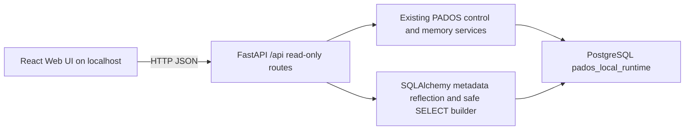

# PADOS Web Control Center Architecture

## Runtime flow

## Backend slices

- `src/pados/web/routes.py`: local-only route registration, pagination and HTTP error mapping.
- `src/pados/web/service.py`: health/system aggregation, service-layer project/memory reads, database metadata, safe row previews, and unified read models for runs/events.
- `src/pados/web/schemas.py`: typed response contracts for health, projects, memory and pagination.
- `src/pados/api/app.py`: registers Corpus Operator and read-only control routes in one application factory. The shared project routes return both Corpus and control-center metadata, so method/path pairs remain unique.

## Frontend slices

- `web/src/main.tsx`: the accepted Corpus Operator workspace and the single-root surface switch.
- `web/src/control-center.tsx`: Dashboard, Projects, Memory, Database, Runs/Events and System pages, all read-only.
- `web/src/api.ts`: typed browser API models and URL/formatting helpers.
- `web/src/styles.css`: desktop-first dark control-center layout with responsive two-column/table behavior.
- `web/vite.config.ts`: localhost Vite server with a configurable local backend proxy.

## Data safety design

1. The API binds to localhost in the web launcher and rejects non-local request clients.
2. Dynamic database objects are allowed only after metadata validation; table objects are reflected through SQLAlchemy.
3. Rows are selected through SQLAlchemy expressions with a hard maximum of 100 rows per page.
4. Filters and sorting accept validated metadata column names only.
5. Secret-like column names and binary values are redacted before response serialization.
6. Error responses use stable generic messages and do not include database URLs or credentials.
7. There are no write routes in `/api/database/*`.

## Integrated surfaces

The browser has one React root with two explicit surfaces: Corpus Operator keeps
the accepted staging, review, authorization, ingest, search, and evidence flow;
Control Center adds the formal read-only runtime explorer. The two surfaces do
not introduce a second application root or a second authorization flow.

## Future extension points

The route namespace leaves room for a future `/api/graph` capability. It is intentionally not implemented until a governed knowledge-graph data contract exists.
