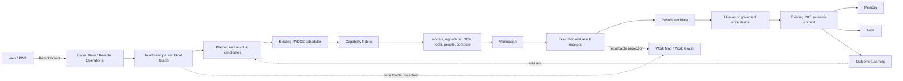

# PADOS

**Intelligent Mindmap-driven Portable Cognitive & Execution Operating System**

PADOS is a **Governed Cognitive & Execution Operating System** and an **AI Execution Authority Layer**. It orchestrates models, algorithms, tools, knowledge, compute, people, and policies around a user's work. It is not another chatbot or a frontend for one model provider.

Project: [Jimmy0307/Pados](https://github.com/Jimmy0307/Pados)

## Why PADOS

Single-model agents run into hardware limits, depend on cloud access, lock work into provider-specific formats, and leave tools and execution decisions fragmented. Their output can look finished without being verified or accepted.

PADOS keeps task intent and execution authority in the system. Models and other workers are replaceable resources in a governed path:

**Task → Capability → Resource → Execution → Verification → Outcome → Learning**

The system can preserve completed work, identify unresolved goals, and route only residual work when compatible capabilities and policy allow it.

PADOS has been informed by and validated against real-world enterprise local-AI and structured problem-solving deployments.

## Core Principles

- **MODEL OUTPUT != TRUTH**
- **EXECUTION COMPLETE != SEMANTIC ACCEPTANCE**
- **REMOTE CLIENT SENDS INTENT, NOT CONTEXT**
- **PROVIDER IS NOT AUTHORITY**
- **CI SUCCESS != DEPLOYMENT AUTHORIZATION**
- System orchestration governs execution; provider APIs do not define PADOS protocols or authority.

## Architecture



The browser sends bounded intent and reads authenticated projections. Home Base reconstructs context and applies existing policy, scheduler, receipt, audit, and CAS authority. The Work Graph is a rebuildable view, not a second source of truth.

## Work Map

The **PADOS Work Map** is the primary web and mobile surface. It presents work as a continuous topology from original intent through goals, workers, capabilities, results, residual work, decisions, and blockers. Pan and follow the lineage; select a node to inspect status, ownership, dependencies, evidence, receipts, and remaining work.

```text
Original task
  ├── Goal A ── capability / worker ── verified result
  ├── Goal B ── partial result ── residual Goal B.2 ── next eligible resource
  └── Goal C ── human decision required
```

The map displays only facts present in the current projection. Missing assignments or receipts remain visibly unassigned or unavailable.

## Residual Completion

If a resource completes part of a task, PADOS preserves the original intent, completed goals, partial results, artifacts, evidence, and provenance. Coverage analysis identifies remaining goals, and a residual task can be planned against those goals only. Policy refusals do not trigger a permissive model bypass. Composed work remains a `ResultCandidate` until verification and governed acceptance; only the existing CAS path commits semantic state.

## Capability Fabric

PADOS can coordinate capability types such as local and cloud language models, OCR, vision, code tools, retrieval, deterministic algorithms such as DRSA/FCM, MCP integrations, Office, and engineering tools. A deterministic algorithm is represented as an algorithm or tool resource, not as an LLM.

Recommendations do not install or authorize integrations. **Recommended, installed, registered, authorized, and selected are separate states.**

## Local-First / Hardware-Aware

PADOS can use small models, specialized workers, quantized models, bounded context, and available local compute. Cloud escalation can be considered only where policy and task needs permit it. No benchmark claims are made here; local model performance remains pending measurement.

## Security / Governance

- One existing CAS authority and one semantic commit path.
- One existing scheduler and one capability router.
- Models cannot authorize themselves or commit semantic state.
- Sandboxed execution and classification boundaries remain system-enforced.
- `SecretRef` and server-side configuration keep provider keys out of the frontend.
- Remote clients send intent only; authentication, project authorization, scope checks, idempotency, audit, and receipts remain Home Base responsibilities.
- The static site distributes UI files only. It is not a backend, scheduler, database, authority, or provider gateway.
- Every approval or rejection requires a fresh WebAuthn step-up with user verification, bound by Home Base to the exact candidate, digest and ScopeVersion and consumed once. A compromised allowed static UI can still read the signed-in actor's in-memory access proof and act within non-decision grants; see [SECURITY.md](SECURITY.md) for residual risks.

Report security issues using the process in [SECURITY.md](SECURITY.md).

## Current Status

**Controlled dogfood: NOT YET DECLARED — Stage A product authority closure passes on VMware Linux (including live PostgreSQL and a live browser approval); Windows-native validation of the same commit is pending. Public release: PENDING owner and legal authorization. These are separate gates.**

| Area | Status |
| --- | --- |
| Accepted foundation | Windows-native and VMware Linux baseline accepted at the frozen common-code checkpoint |
| Capability Fabric V1 | Cross-platform accepted |
| Task and protocol contracts | Contract-level acceptance from Product Completion V1; live multi-capability execution is not accepted |
| Residual completion and scheduler | Residual work is amended into the existing P6.10 TaskLoop (sole scheduler); authority-expanding residuals require re-approval |
| Approval security | Fresh WebAuthn step-up (user verification) with single-use, candidate- and ScopeVersion-bound proofs; validated on VMware Linux, Windows pending |
| Composition and CAS | ResultCandidate -> verification -> step-up approval -> ResultReceipt -> existing StateProofService CAS (exactly once); governed rejection on the same audit chain |
| Work Map and assignment | Rebuildable lineage projection from task through residual, receipts, verification, approval and ResultReceipt to the accepted state (projection only); Work Map UI rendering of the full lineage is limited |
| Mobile Remote Operations | Live local E2E passed on VMware Linux: mobile PWA in Chromium -> guarded Home Base -> PostgreSQL -> CAS with a virtual WebAuthn authenticator |
| Product closure validation | VMware Linux validation recorded; Windows-native validation and exact product-code parity are pending |
| Product database migration | Operational head `20261007_0017` validated on disposable PostgreSQL (fresh and previous head) on Linux; Windows pending |
| Static Pages build | Prepared in the prior product phase; not deployed |
| Live OCR backend | Pending installation and validation |
| Herdr live UAT | Pending |
| Physical hotspot/cellular UAT | Pending |
| Local model benchmark | Pending measurement |
| Public redistribution | Pending. Repository license metadata does not satisfy the outstanding rights and owner-authorization gate |
| Public hygiene | Current export scan classified the tracked export, but the required private organization-marker rules were unavailable; the public boundary is not yet accepted |

Stage A product authority closure is implemented and validated on VMware Linux. Controlled dogfood is declared only after the same commit passes Windows-native validation. Public release remains a separate gate and is not implied by local dogfood readiness.

## Quick Start

The commands below match the checked-in Python and web project setup. Full database provisioning and service configuration are in [docs/product/QUICKSTART.md](docs/product/QUICKSTART.md).

```powershell
python -m venv .venv
.\.venv\Scripts\python -m pip install -c requirements.lock -e ".[dev]"
.\.venv\Scripts\python -m pytest tests\work_protocol tests\remote -q

cd web
npm ci
npm run dev
```

For a static production build, run `npm run build` from `web/`. The Pages build uses `/Pados/` by default; set `PADOS_PAGES_BASE=/` for a custom-domain root build.

## Development Environments

- **Windows native:** use the active validation or development worktree under `%USERPROFILE%\PADOS-worktrees`.
- **VMware Ubuntu:** use the active Linux development worktree or an isolated validation checkout.
- **WSL:** retired for active PADOS development.

The cross-platform baseline is shared code; platform-specific evidence is kept separately. Keep validation changes inside an isolated worktree rather than the protected canonical checkout.

## Web / PWA

GitHub Pages serves static frontend files only. The Work Map connects to an explicitly configured HTTPS PADOS Home Base using authenticated Remote Operations. The service worker caches the app shell and static assets; it does not cache project or API payloads. The frontend has no provider API keys and makes no provider calls.

For a cross-origin static deployment, Home Base must explicitly allow the exact Pages or custom-domain origin in its Remote Operations configuration. Wildcard origins are rejected.

## Repository Structure

- `src/pados/` — Python application and domain modules
- `tests/` — deterministic and integration tests
- `web/` — Work Map PWA and existing operator interface
- `migrations/` — database migrations
- `docs/` — architecture, operations, security, and product documentation
- `examples/` — safe configuration and demonstration inputs
- `scripts/` — development, validation, and release tools
- `.github/workflows/` — CI and static Pages workflow definitions

## Roadmap

- Controlled Dogfood after product and cross-platform gates close
- Local intelligence stack and measured model benchmarking
- Live OCR and Vision engines
- Embedding and reranker capabilities
- Capability Packs, Skills, and governed MCP integrations
- Work Map refinement driven by real use
- Mac and additional Home Base expansion

## License

PADOS Core is licensed under the [GNU Affero General Public License v3.0 only](LICENSE) (`AGPL-3.0-only`; see [`NOTICE`](NOTICE)). The copyright holder may also offer a separate commercial license; see [COMMERCIAL.md](COMMERCIAL.md). Future public SDKs or protocol schemas may be Apache-2.0 only in a separate `sdk/` directory with their own license file. Third-party components keep their own licenses ([THIRD_PARTY_NOTICES.md](THIRD_PARTY_NOTICES.md)). The full map, including how AGPL network use applies to server deployments, is in [LICENSING.md](LICENSING.md).

"PADOS" and the PADOS logo are reserved. The code license grants no trademark rights, and forks must not present themselves as the official PADOS product.

Repository publication clearance is still pending review of component provenance and redistribution rights. Do not treat the presence of a license file as public-release authorization.

## Safety / Responsible Use

Permissive or abliterated models may be evaluated as research or runtime resources. PADOS system policy, sandbox boundaries, authentication, and execution authorization remain in force regardless of model choice. PADOS is not a safety-bypass system.

## Contributing

Contributions will require a signed Contributor License Agreement once one is published (pending legal review); until then external code contributions are not accepted. Contributions should include deterministic tests, protocol and provenance updates where relevant, and evidence for claimed behavior. Do not bypass policy or approval gates to make a check pass. See [CONTRIBUTING.md](CONTRIBUTING.md).
