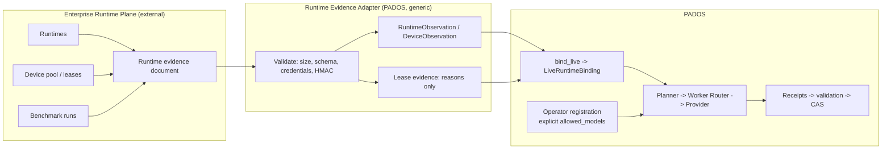

# Enterprise Local Runtime Interop (Enterprise Local Runtime Adapter pattern)

Status: **SPECIFICATION + REFERENCE ADAPTER**. The generic adapter is
`pados.local_intelligence.runtime_evidence`. PADOS has been informed by and validated against real-world
enterprise local-AI and structured problem-solving deployments. This page is generic. It names no vendor,
runtime brand, model, organisation or deployment, and it contains no measurements.

## 1. Two planes, one authority each

Many enterprises already run a local-AI runtime plane: runtime processes, device pools, slot leases, model
stores and their own benchmark runs. PADOS does not replace that plane, and that plane does not become a
second PADOS control plane.

| Concern | Owner |
|---|---|
| Intent, Task Contract, Capability Graph, planning policy | PADOS (`pados.capability`) |
| Execution routing | PADOS Worker Router (`pados.worker.router.select_worker`), the only selector |
| Model identity and measured capability | PADOS `ModelCatalog` + `ModelCapabilityProfile` |
| Model authorization | explicit, operator-written compute-node registration (`allowed_models`) |
| Semantic state, CAS, acceptance | PADOS `StateProofService.commit_result` |
| Receipts, evidence, Outcome Learning | PADOS (advisory learning only) |
| Runtime lifecycle, slot leases and device pools inside the external plane | the external plane, opaque to PADOS |
| Runtime availability, health, device headroom, artifact identity, benchmark runs | produced by the external plane, **verified** by PADOS |

## 2. Data flow

The direction is fixed: Enterprise Runtime Plane → Runtime Evidence Adapter → `RuntimeBinding` → the
existing Provider Router (`LocalInferenceProvider` through the Worker Router). The planner never couples to
the external plane's gateway, orchestration layer, runtime brand or model names. It sees only the generic
contracts below.

## 3. The evidence document

`RuntimeEvidenceDocument` (`schema_version = pados.runtime-evidence.v1`):

| Field | Meaning | Rule |
|---|---|---|
| `plane_id` | opaque label the operator assigned to the plane | label pattern; no hostnames |
| `endpoint_scope` | `LOOPBACK` / `PRIVATE_NETWORK` / `UNKNOWN` | a scope label only, never a URL or address |
| `observed_at` | when the plane observed this state | timezone-aware; stale or future is never fresh |
| `runtimes[]` | `runtime_id`, `runtime_family` label, `version`, `state`, `artifacts[{runtime_ref, manifest_digest}]`, `resident_refs` | unknown `state` becomes `UNAVAILABLE` with a reason |
| `device` | `device_profile_id`, `free_gpu_mib`, `available_ram_mib`, `state` | identity must equal the measured device, or the evidence does not apply (`DEVICE_NOT_MEASURED`) |
| `leases[]` | `lease_id`, `runtime_ref`, `expires_at` | evidence only; an expired lease is a reason |
| `benchmark_evidence_refs[]` | SHA-256 digests of benchmark archives | references to be re-verified, never profiles by themselves |

The adapter projects the document into the frozen `RuntimeObservation` and `DeviceObservation` contracts, so
`bind_live` works unchanged. `bind_external` adds the document-level and lease reasons to the binding.

## 4. What the external plane may and may not do

It **may** supply availability, health, leases, device and resource state, model artifact identity (manifest
digests) and benchmark evidence references. It may refuse or revoke on its side. PADOS then observes
`UNAVAILABLE` or `DEGRADED`, and the route fails closed.

It **may not**:

- mutate PADOS semantic state, ACLs, grants, planner or provider authority, or Outcome Learning conclusions;
- authorize a model. Registration stays explicit, operator-written and digest-pinned. An empty
  `allowed_models` is DENY, and a valid lease changes nothing about that;
- route around the Worker Router, or create a second scheduler, router, registry or catalog;
- substitute an artifact. Artifacts are matched by manifest digest only. A same-named artifact with another
  digest is `MODEL_ARTIFACT_NOT_PRESENT`.

**Leases are evidence, not authorization.** A lease never turns a state `AVAILABLE`, never registers and never
authorizes. It can only add reasons (`EXTERNAL_LEASE_EXPIRED`, `EXTERNAL_LEASE_RUNTIME_REF_UNKNOWN`).

## 5. Fail-closed validation

`ingest_runtime_evidence` never raises into the planner. It returns a `RuntimeEvidenceResult` with closed
reason codes that never echo submitted values:

- size bound (`EVIDENCE_DOCUMENT_TOO_LARGE`), duplicate keys and non-JSON (`EVIDENCE_DOCUMENT_MALFORMED`),
  unknown fields and schema violations (closed codes);
- credential material, `secretref://` values, URLs with user info, query strings or fragments, and
  over-long strings are refused (`EVIDENCE_CREDENTIAL_MATERIAL`, `EVIDENCE_URL_HAS_CREDENTIALS`,
  `EVIDENCE_URL_HAS_QUERY`, `EVIDENCE_STRING_TOO_LONG`);
- integrity: the operator configures an `EvidenceKey`, resolved through
  `pados.enterprise.secrets.SecretBoundary` from a `secretref://` reference (`EvidenceKey.from_secret_ref`
  is its only constructor), and a document is accepted only with a valid HMAC-SHA256 signature over its exact
  bytes. Without a key, documents are refused (`EVIDENCE_UNAUTHENTICATED`). Only an explicit,
  development-only `allow_unauthenticated=True` accepts them, marked `EVIDENCE_UNAUTHENTICATED`.

A refused document contributes no observations, so binding is `UNAVAILABLE` (`RUNTIME_NOT_DISCOVERED`,
`DEVICE_STATE_UNAVAILABLE`). The module performs no network I/O. Transport and its authentication belong to
the caller.

## 6. Measured execution contract

The measured execution contract applies unchanged
(`docs/architecture/MEASURED_CAPABILITY_EXECUTION_CONTRACT.md`). An external runtime's capability holds only
under the execution configuration it was measured with, on the measured runtime version and device. External
benchmark results enter PADOS only by re-verification into a `ModelCapabilityProfile` with measured execution
conditions. A replacement model needs no PADOS code change: it is a new artifact with a new profile.

## 7. Acceptance criteria for a deployment-specific adapter

1. It produces only `RuntimeEvidenceDocument`s (or `RuntimeObservation` / `DeviceObservation` / evidence
   archives). It imports no PADOS planner, router, registry or state-proof module.
2. Revocation on the external side makes the next PADOS selection or execution fail closed.
3. A live dogfood run equivalent to the Stage B chain passes, with an independent PADOS verifier.
4. No organisation data, hostnames, credentials or private measurements appear in PADOS evidence or in public
   material. Deployment-specific adapter code stays with its owner.
