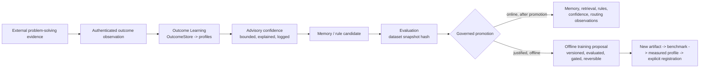

# Governed Outcome Learning Interop (Governed Outcome Learning Adapter pattern)

Status: **SPECIFICATION + REFERENCE ADAPTER**. The generic adapter is `pados.learning.external_outcomes`. It
builds on Outcome Learning V1 (`docs/learning/OUTCOME_LEARNING_V1.md`, `pados.learning`). PADOS has been
informed by and validated against real-world enterprise local-AI and structured problem-solving deployments.
This page is generic. It names no organisation, method brand or system, and it contains no case data or
measurements.

## 1. What "learning" means

A structured problem-solving process (case intake, containment, root cause, corrective action, effectiveness
check) produces evidence about what worked. In PADOS that evidence improves advice. It never changes
authority, and no single case modifies model weights.

- **Online learning** adjusts memory, retrieval, rules, confidence and routing observations, and only after
  evaluation and governed promotion.
- **Fine-tuning** (LoRA, adapters, full fine-tuning) is offline, versioned, evaluated, gated and reversible.
  It never runs online and never overwrites production weights. Its result re-enters PADOS only as a new
  measured artifact: new manifest digest, benchmark, `ModelCapabilityProfile` with execution conditions, then
  explicit registration. Rollback means the previous artifact stays registered.

## 2. The adapter contract

| Step | PADOS contract | Rule |
|---|---|---|
| External evidence | `ExternalOutcomeObservation` | content-free: closed vocabularies, bounded numbers, SHA-256 digests. Case text, people and data never enter PADOS |
| Authenticated outcome | `outcome_from_external` → `OutcomeRecord.from_receipts` | only through the existing `OutcomeAuthenticator`: trusted receipt, trusted plan context, governed decision. Otherwise `LEARNING_OUTCOME_UNAUTHENTICATED` |
| Outcome Learning | `OutcomeStore`, `CapabilityPerformanceProfile` | non-authoritative statistics |
| Advisory confidence | `OutcomeAdvisor` | disabled by default; bounded to `ADVICE_BOUND`; feasible set only; logged and anchored |
| Memory / rule candidate | `LearningCandidate` (`MEMORY`, `RULE`, `RETRIEVAL`, `ROUTING_OBSERVATION`, `CONFIDENCE`) | inert data: authority `NONE`, status `CANDIDATE`, evaluation and governed promotion required |
| Evaluation | `EvaluationRecord` | bound to a dataset snapshot hash |
| Governed promotion | the existing human / operator decision path | never automatic |
| Offline training request | `TrainingProposal` | inert: `requires_offline_evaluation`, `gated`, `versioned`, `reversible`, `online = False`, result enters as `NEW_MEASURED_ARTIFACT` |

The adapter defines no write, apply, promote, deploy or train path, and it imports nothing that has one. The
`tests/learning/test_boundary.py` import rules apply to it.

## 3. What an external system can never do

An external system cannot:

- change ACLs, grants, classification, planner or provider authority;
- authorize, register or deploy a model;
- change semantic authority or CAS truth. Only `StateProofService.commit_result` commits;
- rewrite production weights online;
- fabricate human confirmation.

## 4. Human confirmation is never fabricated

`HumanDecision.ACCEPTED` / `REJECTED` exists only when the governed approval path resolves a recorded decision
(`OutcomeAuthenticator.resolve_decision`). The external process's own assessment (`ExternalFeedback`:
`RESOLVED_EFFECTIVE`, `RESOLVED_INEFFECTIVE`, `RECURRED`, `UNRESOLVED`, `UNKNOWN`) is learning evidence. It
is never a human decision, and the observation has no field that could carry one. Passing verification is not
acceptance. Missing confirmation stays `NONE`.

## 5. Memory concepts mapped to PADOS

| Memory | PADOS counterpart |
|---|---|
| Working (current case) | bounded task / stage context |
| Episodic (past cases) | receipts and content-addressed evidence references |
| Semantic (stable knowledge) | governed knowledge, committed only through CAS |
| Rule | `LearningCandidate(kind=RULE)` → evaluation → governed promotion |
| Failure | closed `FailureCode` vocabulary and outcome statistics |
| Outcome | `OutcomeRecord` (authenticated, content-free) |
| Model performance | `CapabilityPerformanceProfile` (advisory) and `ModelCapabilityProfile` (measured) |

## 6. Boundary

Deployment-specific connectors, case data and process records stay with their owner. This page fixes only
the PADOS side of the contract.
