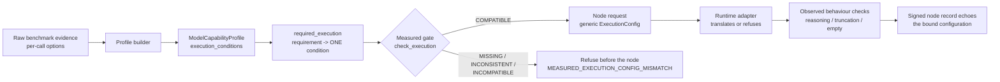

# Measured Capability Execution Contract

Status: **ACCEPTED** (Stage B M4.2, live on the Windows reference node, independently verified on Linux).
Code: `src/pados/resources/capability_profile.py` (contract), `src/pados/compute_node/provider.py` (gate),
`src/pados/compute_node/backends.py` (runtime adapters), `src/pados/local_intelligence/profile_builder.py`
(derivation from evidence).

## Rule

A capability is not a property of a model. It is a measurement of:

```
CAPABILITY = MODEL ARTIFACT x RUNTIME x DEVICE x EXECUTION CONFIGURATION x EVIDENCE
```

So a **measured capability is not an unconditioned model property**. PADOS may claim a measured capability
only while it executes under the capability-critical settings the measurement used. The execution gate must
never run a "measured" route under materially different settings. If the settings are **missing**,
**inconsistent**, **incompatible** or **unverifiable**, it fails closed.



## Generic vocabulary (planner-facing)

`ExecutionConfig` is runtime-independent. The planner, Worker Router bridge and stage adapter never see
runtime parameter names. A static test enforces this.

| Field | Meaning | Compatibility rule |
|---|---|---|
| `context_window` | tokens of context the runtime allocates | must equal the measured value |
| `reasoning_mode` | `DISABLED` / `ENABLED`: a separate reasoning phase before the visible answer | must equal |
| `temperature` | sampling temperature | must equal |
| `seed` | sampling seed (or none) | must equal |
| `output_constraint` | `UNCONSTRAINED` / `JSON_SCHEMA` (schema-constrained decoding) | must equal |
| `max_output_tokens` | output budget | must cover the largest completion the measured runs needed (or the measured budget when that is unknown) |

`MeasuredExecutionCondition` binds one `ExecutionConfig` to the capabilities measured under it. It also
records the largest observed completion, the sample size and evidence references.

### Requirement resolution

`required_execution(profile, requirement)` collects every capability the requirement claims: its floors,
plus long-context, latency and throughput bounds when they are set. It returns the **one** condition under
which all of them were measured. Several matching conditions are resolved only when they differ in the
context window alone, and then the smallest sufficient window wins. Otherwise:

- `MEASURED_EXECUTION_CONFIG_MISSING:<capability>`: a claimed capability has no recorded condition.
- `MEASURED_EXECUTION_CONFIG_INCONSISTENT`: the claimed capabilities were measured under different
  capability-critical settings.

`assess()` adds this refusal, so a profile whose conditions are unknown is never routable. A profile built
before conditions were recorded keeps its identity, because an empty list is omitted from the hash, but it
supports no requirement.

## Enforcement points

1. **Admission** (`LocalInferenceProvider.measured_check`). The route carries the bound
   `MeasuredExecutionCondition`. Re-validation before and after execution compares it.
2. **Before submission** (`effective_execution`). The effective configuration is the bound condition plus
   the caller's output budget and output constraint. Nothing else can be changed: `execute()` has no
   configuration parameter. Anything not `COMPATIBLE` raises
   `EXECUTION_GATE_REFUSED:MEASURED_EXECUTION_CONFIG_MISMATCH:<field>`, and the node is never contacted.
3. **Runtime adapter** (`backends.py`). The adapter translates the generic fields or refuses with
   `EXECUTION_CONFIG_UNVERIFIABLE`. The generic OpenAI-compatible API has no portable per-request context
   window or reasoning switch, so it refuses. Observable violations fail closed:
   - `EXECUTION_CONFIG_NOT_APPLIED:reasoning_mode`: reasoning text appeared although it was disabled.
   - `OUTPUT_TRUNCATED`: `done_reason=length`.
   - `EMPTY_COMPLETION`.
4. **Node record**. The MAC-signed record and the node receipt carry the configuration. The provider requires
   the record and the adapter's `execution_requested` echo to equal what it sent; otherwise it raises
   `MEASURED_EXECUTION_CONFIG_NOT_APPLIED`. The echo proves what was *requested*. Behaviour is covered by
   point 3.

### Ollama translation (adapter-only)

| Generic | Ollama `/api/chat` |
|---|---|
| `reasoning_mode` | top-level `think` (bool) |
| `output_constraint=JSON_SCHEMA` | top-level `format` (the caller's schema) |
| `context_window` | `options.num_ctx` |
| `max_output_tokens` | `options.num_predict` |
| `temperature`, `seed` | `options.temperature`, `options.seed` |

The placement is the one the benchmark used against the installed runtime (0.34.3). The benchmark produced
the evidence, so its request shape is authoritative for this runtime.

## Consumer binding (graph cognition and other chat callers, RC2 D2)

The consumer path (`build_chat_provider` used by `process_cognitive_item` and `refresh_living_synthesis`)
no longer calls the runtime with its own defaults. A local chat model is built only as a
`MeasuredChatProvider` over a `BoundExecution` from `pados.providers.execution_binding.resolve_bound_execution`.
The resolver lives in `pados.providers`, not in `pados.local_intelligence`, because that package must not
import the authorization modules: it measures and is never an authority.

### Resolver steps (each refusal is typed; nothing falls back to runtime defaults)

| # | Step | Refusal code |
|---|---|---|
| 1 | `PADOS_MODEL_CATALOG` is set | `MEASURED_PROFILE_STORE_NOT_CONFIGURED` |
| 2 | `ModelCatalogStore.load()` re-validates every profile, including the recomputed `profile_id` | `MODEL_CATALOG_STORE_INVALID` |
| 3 | Exactly one profile has `artifact.runtime_family == PADOS_CHAT_PROVIDER` and `artifact.artifact_ref == PADOS_CHAT_MODEL`. The tag is only a lookup key. | `MODEL_PROFILE_NOT_REGISTERED`, `MODEL_PROFILE_AMBIGUOUS` (reasons: the profile ids) |
| 4 | `LiveLocalState` + `bind_live`: manifest digest present, measured runtime version, measured device, fresh state | `LIVE_BINDING_REFUSED` (reasons: the binding reasons, for example `MODEL_ARTIFACT_NOT_PRESENT`, `RUNTIME_VERSION_NOT_MEASURED`, `DEVICE_NOT_MEASURED`) |
| 5 | `PADOS_COMPUTE_NODES_CONFIG` is set and loads | `MODEL_AUTHORIZATION_NOT_CONFIGURED`, `MODEL_AUTHORIZATION_STORE_INVALID` |
| 6 | `registration_authorizes` over those registrations, for the project and `INTERNAL` classification; the registration must name the profile's immutable `model_ref` | `MODEL_NOT_AUTHORIZED` |
| 7 | Intent to requirement through one table (`STRUCTURED_OUTPUT` to `STRUCTURED_JSON`, `TEXT_SUMMARY` to `SUMMARIZATION`), then `required_execution` | `MEASURED_EXECUTION_CONFIG_MISSING` (reason: the capability), `MEASURED_EXECUTION_CONFIG_INCONSISTENT` |
| 8 | `assess` must be eligible (DEGRADED is not accepted) | `MEASURED_INELIGIBLE` (reasons: assessment and binding reasons) |
| 9 | `check_execution(measured, measured.config)` must be `COMPATIBLE` | `MEASURED_EXECUTION_CONFIG_MISMATCH` |

`required_execution` runs before `assess` so that a missing or inconsistent condition has its own code
instead of being folded into `MEASURED_INELIGIBLE`.

At call time the provider adds three refusals:
- `MEASURED_EXECUTION_CONFIG_MISMATCH:output_constraint` when a schema-constrained condition gets no schema,
  or an unconstrained condition gets one. The request is never sent.
- `MEASURED_EXECUTION_CONFIG_NOT_APPLIED` when the backend's `execution_requested` echo differs from the
  bound configuration.
- `MEASURED_EXECUTION_INTENT_REQUIRED` when a caller asks for a real model without an intent and a project.

Translation stays in `OllamaBackend.run` / `ollama_chat_body`. The provider reuses it and does not
duplicate it.

### Graph behaviour

The graph sends the one `COGNITIVE_RESPONSE_SCHEMA` (`pados.graph.cognition`) with intent
`STRUCTURED_OUTPUT`. The project scope is the workspace's project. A workspace without a project is its own
scope (`workspace:<id>`). On a refusal, the work item becomes `BLOCKED` with `error_code` set to the refusal
code. The API answers 409 `MEASURED_EXECUTION_REFUSED`, with `details.refusal_code` and `details.reasons`.
A backend timeout maps to the existing `TIMEOUT` failure.

On success, `measured_execution` evidence is stored in the candidate node `metadata_json` and in the work
item's `candidate_outputs`, and `cognitive_runtime_status` is `MEASURED_BINDING_APPLIED`. The mock provider
is used only when `PADOS_CHAT_PROVIDER=mock`, and it keeps `MOCK_CONTRACT_TEST_ONLY`.

### Evidence fields

The evidence has schema `pados.providers.measured-execution.v1`. It holds:
- the binding: `intent`, `profile_id`, `model_ref`, `manifest_digest`, `runtime_ref`, `runtime_version`,
  `device_profile_id`, `binding_hash`, `requirement_hash`;
- the configuration: `execution` (the generic `ExecutionConfig`), `config_hash`;
- the call: `endpoint` (scheme://host:port only), `authorization` (`COMPUTE_NODE_REGISTRATION`),
  `timeout_seconds`;
- the runtime counters reported by the backend: `done_reason`, `eval_count`, `prompt_eval_count`,
  `total_duration`, `response_schema_sha256`.

It contains no prompt, content or credential.

### Operator steps

1. **Import.** Add an accepted measured profile to the catalog file named by `PADOS_MODEL_CATALOG`. Use
   `ModelCatalogStore(path).update(lambda c: c.register(profile_from_capability(p, license=...)).register_capability_profile(p))`.
   That is the existing store and catalog API. Importing only registers the profile and never authorizes it.
2. **Authorize.** In the compute-node registry named by `PADOS_COMPUTE_NODES_CONFIG`, a registration must
   have `authorized: true` and `LOCAL_INFERENCE` in `allowed_capabilities`. Its `project_ids` must admit the
   project (or `*`), and `allowed_models` must contain the profile's exact `model_ref`
   (`<runtime_family>/<artifact_ref>@<manifest digest>`).
3. **Revoke.** Remove the `model_ref` from `allowed_models`, or set `authorized: false`. The next call is
   refused with `MODEL_NOT_AUTHORIZED`.
4. **Check.** `pados doctor` (with device checks) reports `providers: MEASURED_BINDING_UNAVAILABLE` with the
   refusal code. The doctor checks with project scope `*`, so only a wildcard registration counts as
   authorized there.

### Timeout (not re-tuned)

The per-call bound is `PADOS_LOCAL_INFERENCE_TIMEOUT_SECONDS`. It defaults to 30 s, the previous fixed value,
and is bounded to 1..600. It is recorded in the evidence. It has **not** been re-tuned. It will be
re-evaluated only with the evidence from RC2 gate 2.

## Failure evidence

A node job that does not succeed raises `NodeExecutionError` with `failure` (schema
`pados.compute-node.failure-evidence.v1`). It records:

- the request and job ids and the terminal state;
- the complete, bounded normalized code (for example `JOB_FAILED:EMPTY_COMPLETION`);
- the backend counters, re-filtered to integers and short labels (`done_reason`, `eval_count`,
  `thinking_chars`, …);
- whether the record MAC verified, and the record itself, only when verified and bounded;
- `node_receipt = NOT_ISSUED_FOR_FAILED_EXECUTION` and `semantic_authority = NONE`.

Prompts, content and credentials are never included.

## Evidence for the rule (Stage B)

| Observation | Source |
|---|---|
| The extraction capability was measured with `think=false`, `num_ctx=8192`, `temperature=0`, `seed=42`, a JSON schema, and a largest completion of 68 tokens | M3.1 profile `mcp-bd7794d4…`, re-derived identically on Windows and Linux |
| The only reasoning-enabled measurement needed 1327 output tokens | same profile, `REASONING_EXTENDED` condition |
| The pre-fix live request (`num_predict=256`, `temperature=0`, nothing else) returned **EMPTY_COMPLETION**: `done_reason=length`, 256 tokens all spent on 972 characters of reasoning, 0 visible characters, despite a `/no_think` prompt hint | `POST_HOC_REPRODUCTION.json` (real RTX 5070 / Ollama 0.34.3) |
| With the bound configuration, the same task produced a correct extraction (65 tokens, `done_reason=stop`) | same file; live dogfood archive `f81036e8…` |

## Known limits

- `output_constraint` binds the constraint *kind*. The caller's schema is recorded by hash. The measured
  quality numbers come from the benchmark's own schemas.
- Runtime server-side settings (environment variables of the runtime process) are captured as integrity
  telemetry but are not part of the condition.
- Concurrency, timeout recovery and reload stability carry no condition, so no requirement can claim them as
  measured.
