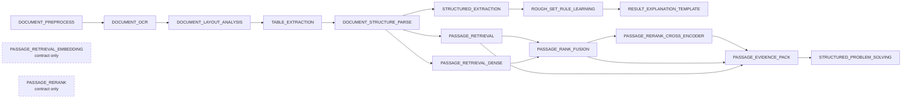
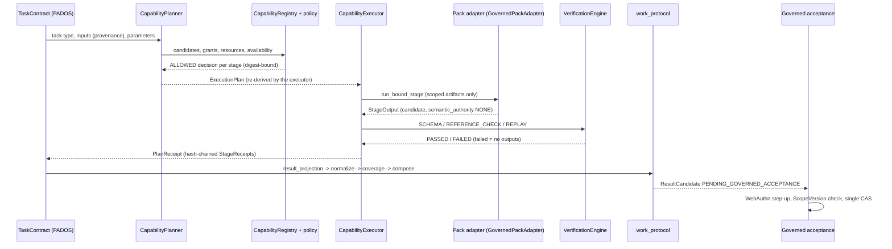
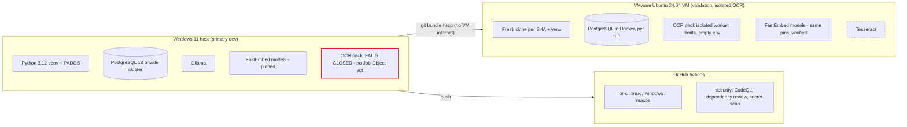
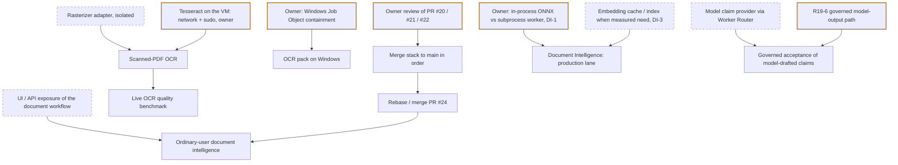

# PADOS architecture and development progress (2026-11-14)

A standalone HTML view of this snapshot is `docs/architecture/pados-progress-2026-11-14.html`. This is a snapshot of the state on 2026-11-14, built from GitHub PR state and machine evidence. It does not change
any authority, and it does not override `ARCHITECTURE.md` or `ROADMAP.md`. In the diagrams, solid nodes are
implemented. Dashed nodes or edges, labelled *proposed* or *pending*, do not exist yet.

## 1. Where the code is

| Line | Head | Base | State | Readiness (lane gate, exact head) |
| --- | --- | --- | --- | --- |
| `main` | `69716ed` (PR #19 merge) | — | canonical | RC2 local-dogfood tag line |
| PR #20 operability (OP-001…010) | `dd8dcf3` | `main` | draft; body says "needs owner review" | local-supervised-dogfood READY; production NOT_READY |
| PR #21 local usability | `034fce6` | #20 | draft, needs owner review | local-supervised-dogfood NOT_READY (windows-ci-gates timing tests at that head) |
| PR #22 runtime hardening | `205543a` | #21 | draft | local-supervised-dogfood READY; production NOT_READY |
| PR #24 document intelligence (this round) | see PR | #22 | draft | validation recorded on the PR |
| PR #17 AI-Scientist-v3 pack | — | `main` | draft | runtime NOT_VALIDATED |
| PR #25 DI hardening (worker, private model copy, artifact read fix, OCR candidate) | see PR | #24 | draft | see `docs/releases/PR_OWNER_DECISION_DOSSIER_2026-11-14.md` |

Nothing was merged in this round. All three stacked PRs say they need owner review, and an owner review cannot be
self-approved.

## 2. Product architecture

```mermaid
flowchart TB
  subgraph Clients
    UI[Web console / Decision Inbox]
    PWA[Static PWA (Remote Ops)]
    CLI[pados CLI]
  end
  subgraph HomeBase["Home Base (local, loopback + authenticated remote)"]
    API[API / control token / WebAuthn step-up]
    ENV[TaskEnvelope intake]
    LOOP[TaskLoop - the only scheduler]
    ROUTER[Worker / Provider Router]
    FAB[Capability Fabric: registry, planner, executor, verification, receipts]
    WP[Work protocol: coverage, composition, ResultCandidate]
    ACC[Governed acceptance]
    CAS[(StateProof CAS)]
    OPDB[(Operational DB)]
    OBJ[(Content-addressed objects)]
  end
  subgraph Packs["Capability packs (never authority)"]
    OCR[OCR pack]
    RET[Retrieval: BM25]
    DI[Document Intelligence: dense, fusion, rerank, evidence]
    PS[Structured Problem Solving]
    ALG[Algorithms: DRSA, DEMATEL, FCM]
    REF[Reference pack]
  end
  subgraph Engines["Optional engines / runtimes (evidence providers)"]
    PYPDF[pypdf text layer - isolated]
    FE[FastEmbed + ONNX Runtime - pinned models]
    OLL[Ollama - measured local model]
    TESS[Tesseract / PaddleOCR]:::pending
    REA[REA / OpenMAIC / AI-Scientist]:::pending
  end
  UI --> API
  PWA --> API
  CLI --> API
  API --> ENV --> LOOP --> ROUTER --> FAB
  FAB --> Packs
  OCR --> PYPDF
  DI --> FE
  ROUTER --> OLL
  OCR -.-> TESS
  FAB --> WP --> ACC --> CAS
  LOOP --> OPDB
  FAB --> OBJ
  REA -.-> FAB
  classDef pending stroke-dasharray: 5 5
```

## 3. Capability dependency graph (document line)



## 4. Task → Capability → Resource → Verification → Outcome



## 5. Document intelligence workflow

See `docs/packs/document_intelligence/README.md` (workflow diagram, contracts, failure semantics) and
`BENCHMARK_2026-11-14.md`.

## 6. Cross-platform deployment



## 7. Status by module

| Module | Contract | Synthetic validation | Live runtime validation | Notes |
| --- | --- | --- | --- | --- |
| Authority layer (envelope, scheduler, registry, executor, CAS) | frozen | yes | Windows + VMware E2E | Core not expanded |
| Capability Fabric / Pack V1 | yes | yes | Windows + VMware | — |
| OCR pack: pypdf text layer | yes | yes | **VMware Linux** (isolated); Windows fails closed | R19-3 |
| OCR pack: Tesseract / PaddleOCR / vision | yes | fakes | **NOT_VALIDATED** | no engine installed, no rasterizer (DI-4) |
| BM25 retrieval | yes | yes | Windows + Linux | — |
| Dense retrieval (new) | yes | yes | **Windows + VMware Linux** (pinned bge-small) | synthetic corpus only |
| Cross-encoder rerank (new) | yes | yes | **Windows + VMware Linux** (pinned MiniLM) | SHADOW default |
| RRF fusion (new pack stage; formula reused) | yes | yes | Windows + Linux | underperformed dense here |
| Evidence pack hand-off (new) | yes | yes | Windows + Linux | label-based (DI-5) |
| Structured Problem Solving | yes | yes | deterministic drafter only | model claim provider NOT_VALIDATED |
| Enterprise retrieval stack | yes | yes | in-memory only | separate from packs |
| Local model execution (Ollama) | yes | yes | measured (Stage B) | output never reaches CAS (R19-6) |
| REA / OpenMAIC / AI-Scientist-v3 | yes | fakes | **NOT_VALIDATED** | optional runtimes |
| pgvector persistence | placeholder columns | — | — | not needed by the measured use |
| Remote Ops / PWA / WebAuthn | yes | yes | VMware Linux (virtual authenticator) | Windows step-up pending |

## 8. What an ordinary user can do today (local, supervised, synthetic or non-sensitive data)

- Install, run `pados init` and `pados serve`, and use the web console and Decision Inbox.
- Submit work requests and approve work packages.
- Watch deterministic tasks reach COMPLETED with receipts.
- Accept a verified ResultCandidate through a WebAuthn step-up into the single CAS commit.
- New, operator-wired (not yet exposed in the UI or API): run a governed document → evidence → grounded 8D report
  workflow with local embedding and reranking models. The report becomes a ResultCandidate that waits for the
  existing governed acceptance.

## 9. Core vs pack boundary

The Core holds every authority. It is frozen: `TaskEnvelope`, TaskLoop, `CapabilityRegistry`,
`CapabilityExecutor`, router, policy, approvals, receipts, verification, `ResultCandidate`, CAS and audit.

Packs add capabilities through manifests and adapters. Their outputs are candidates. This round changed Core
code in two additive places only:

- `wire_pipeline(extensions=...)`. The registries still refuse overrides.
- `reciprocal_rank_fusion`, extracted from the enterprise pipeline with unchanged behaviour.

## 10. Remaining roadmap and dependencies



## 11. Reuse accounting (this round)

| | Lines |
| --- | --- |
| New pack source (`src/pados/packs/document_intelligence`) | 1,828 |
| New tests and synthetic corpus | 1,358 |
| New operator and benchmark scripts | 377 |
| Existing Core and pack code changed | +41 / −9 (4 files) |
| Existing code exercised unchanged by the slice: OCR pack 4,549; retrieval 455; problem solving 825; capability fabric 6,215; work protocol 2,773; enterprise retrieval, rerank, pipeline and intelligence wiring 2,378 | ≈ 17,200 |

There is roughly 9 lines of reused, already-validated code per new line. The engines were not rebuilt:
FastEmbed, ONNX Runtime and the model weights are third-party. The following were **not** built because they
already existed:

- an OCR framework
- a reranker framework (DISABLED / SHADOW / ACTIVE was reused)
- an RRF implementation
- grounding, abstention and conflict logic
- a ResultCandidate path
- a vector database
