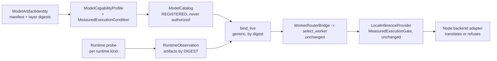

# Stage C: Multi-Model / Multi-Runtime Capability Fabric

Status: **`CONTRACT_ACCEPTED_FAKE_RUNTIME; PHYSICAL_ACCEPTANCE_PENDING`**

This status means the generic path is proven end to end against deterministic loopback fakes of two runtimes. No
real model has run on the second runtime. Physical acceptance is a separate layer (see the last section) and is
**not** claimed here.

Code: `src/pados/compute_node/backends.py` (`LlamaCppServerBackend`, kind `llama_cpp_native`),
`src/pados/compute_node/artifact_identity.py` (PADOS-derived artifact digest),
`src/pados/local_intelligence/runtimes.py` (`LlamaCppServerRuntimeProbe`). Tests:
`tests/local_intelligence/test_stage_c_multi_runtime.py`, `tests/local_intelligence/test_stage_c_llama_cpp_adapter.py`,
fake `tests/local_intelligence/fake_llama_server.py`, composition `tests/local_intelligence/stage_c_support.py`.

## Claim

Another model **and** another runtime can enter PADOS without changing the planner, the scheduler, the Worker
Router, provider routing or semantic authority:

Everything that knows a runtime is on the edges: the **runtime probe** (discovery) and the **node backend adapter**
(execution). Between them only generic vocabulary travels: digests, opaque labels, `ExecutionConfig`.

## What changed (and what did not)

| Area | Change |
|---|---|
| Planner, executor, `CapabilityRegistry`, Worker Router (`pados.worker.**`), scheduler / TaskLoop, `ModelCatalog` (`resources/models.py`), `state_proof`, provider routing (`compute_node/provider.py`), `capability/inference.py`, Local Inference stage adapter | **None.** |
| `resources/capability_profile.py` (frozen contract) | **None.** No addition was needed. |
| `compute_node/backends.py` | New `LlamaCppServerBackend` and kind `llama_cpp_native`. The existing `llama_cpp` kind is unchanged: it still maps to the generic OpenAI-compatible backend, which still refuses measured configurations. Two bounded counter keys were added to `safe_detail`. |
| `compute_node/artifact_identity.py` | New. PADOS-derived content digest for a single-file artifact under an operator-configured root. |
| `compute_node/config.py`, `service.py`, `public.py` | Additive. The kind is allowed. `BackendConfig.artifact_root` is optional and only valid for `llama_cpp_native`; the service passes it to the backend. The public label is `LLAMA_CPP_BACKEND`. |
| `local_intelligence/runtimes.py` | New `LlamaCppServerRuntimeProbe`. `RuntimeEndpoint.artifact_root` is optional and scoped to that kind. |

## What each adapter translates or verifies

`ExecutionConfig` is generic. Each runtime adapter either reproduces every field or refuses.

| Generic field | Ollama (`/api/chat`, Stage B) | llama.cpp server (`/v1/chat/completions`, Stage C) |
|---|---|---|
| `context_window` | **requested**: `options.num_ctx` | **verified, not requested**. The server fixes it at start (`--ctx-size`, split across `--parallel` slots). `/props` `default_generation_settings.n_ctx` must equal the measured window, both before and after the call. Unknown → `EXECUTION_CONFIG_UNVERIFIABLE:context_window`. Different → `EXECUTION_CONFIG_MISMATCH:context_window` (bounded detail: both windows). Changed during the call → `RUNTIME_CHANGED_DURING_EXECUTION`. |
| `reasoning_mode` | `think` | `chat_template_kwargs.enable_thinking` |
| `output_constraint=JSON_SCHEMA` | `format` | `response_format = {"type": "json_schema", "json_schema": {"name", "schema"}}` |
| `max_output_tokens` | `options.num_predict` | `max_tokens` |
| `temperature`, `seed` | `options.temperature`, `options.seed` | `temperature`, `seed` (omitted when the measured seed is none) |
| served model | `model` (selects it) | Verified. A single-model server answers with whatever it loaded, whatever the request names, so the requested model must be the one `/v1/models` lists (`MODEL_NOT_FOUND`). Several served models → the window cannot be attributed → UNVERIFIABLE. |

Observable checks are the same on both adapters:

- Reasoning text although it was disabled → `EXECUTION_CONFIG_NOT_APPLIED:reasoning_mode`. On llama.cpp that means
  `reasoning_content`, or a non-empty inline `<think>` block.
- Cut off by the budget (`done_reason` / `finish_reason` = `length`) → `OUTPUT_TRUNCATED`.
- No visible answer → `EMPTY_COMPLETION`.

The echo `execution_requested` proves what was requested. On llama.cpp the receipt also carries
`context_window_verified`. The generic OpenAI-compatible backend (kinds `openai_compatible`, `llama_cpp`,
`mlx_openai_compatible`) has no portable per-request window or reasoning switch, so it still refuses any measured
configuration (`EXECUTION_CONFIG_UNVERIFIABLE`).

Runtime-specific field names appear only in `backends.py` (adapter) and `runtimes.py` (probe). A static test scans
the protected authorities (planner, executor, registry, inference bridge, Worker Router, scheduler, TaskLoop engine,
ModelCatalog, capability-profile contract, provider, stage adapter, live binding). The scan finds no model, vendor
or runtime tokens, and no runtime parameter identifiers.

## Artifact identity on a runtime that reports no digest

`bind_live` binds by **manifest digest**, never by name. A llama.cpp server reports a model **path** and an alias,
not a digest. PADOS does not fabricate one.

- **Default (no `artifact_root`).** Discovery reports `digest=None`. The binding is `MODEL_ARTIFACT_NOT_PRESENT`,
  and the node marks the declared model `DIGEST_MISMATCH`. Nothing on this runtime is routable. This is fail-closed.
- **Operator-configured `artifact_root`** (absolute; `RuntimeEndpoint.artifact_root` for discovery,
  `BackendConfig.artifact_root` for the node). PADOS takes the `model_path` the server reports in `/props` and
  hashes that file if it lies under the root:
  - `layer digest = sha256(file bytes)`
  - `manifest digest = sha256(canonical JSON {"schema": "pados.local-artifact-manifest.v1", "media_type": "application/x-gguf", "layers": [{"digest", "size_bytes"}]})`

  The canonical JSON uses sorted keys and the `,` / `:` separators. Anyone holding the file can reproduce the
  digest. It is content-addressed: renaming or moving the file does not change it, and changing a byte does.
  The file is refused (`None`, no digest) when:
  - the path is relative (the server's working directory is unknown);
  - the path is outside the root, or reaches outside it through `..` or a link;
  - the file is a link, not a regular file, or lacks the `GGUF` magic;
  - the model is split into several files;
  - the file changed while it was being hashed;
  - any I/O error occurs.
  Hashes are cached by (path, size, mtime, inode, device), so a later observation re-reads nothing unless the file
  changed.
- **Not implemented (documented option).** A signed sidecar manifest. A plain sidecar would be an unverifiable
  claim, so it is not accepted.

The profile's `ModelArtifactIdentity` for this runtime uses exactly these two digests. The identity is the same on
discovery, the node's model availability check and the profile.

## Proven on fakes (tests)

| Scenario | Result |
|---|---|
| A different model on a different runtime, through the same planner and capability contract | The governed chain completes. The output is validated, and the node receipt is verified and carries the bound configuration plus the verified window. The fake's reasoning phase would empty the answer unless `enable_thinking=false` is applied. |
| Catalog with two measured profiles on two runtimes | The unchanged Worker Router selects deterministically (repeated selections are equal). Revoking the selected model's explicit authorization makes the next run use the other runtime. Revoking both blocks. |
| Empty `allowed_models` | DENY (`WORKER_ROUTER_BLOCKED`; every candidate is `DISABLED`/`NOT_AUTHORIZED`). |
| Profile without execution conditions | Never routable (`MEASURED_EXECUTION_CONFIG_MISSING`), even when explicitly authorized and bindable. |
| Floor `INVALID_MEASUREMENT` / `NOT_MEASURED` | Never routable. |
| A new model-brand label (two variants) | Completes with zero code change. The label occurs nowhere in `src/`. |
| Server started with another context window | Fails closed at the node before any inference (`JOB_FAILED:EXECUTION_CONFIG_MISMATCH:context_window`). There is no output and no receipt, and the failure evidence is MAC-verified. |
| `/props` unavailable | The runtime is `PROBE_FAILED` and the digest is unknown, so the profile is never routed. |
| No artifact root, or the same alias serving another file | `MODEL_ARTIFACT_NOT_PRESENT`; never routed. |

## Runtime API facts used: verification status

No real llama.cpp server was available to this work. Every field below follows the upstream llama.cpp
`tools/server` documentation as understood at the time of writing. Each one is an **assumption** until the
physical acceptance layer checks it against the installed build. A wrong assumption fails closed: a missing field
gives UNVERIFIABLE, unknown, or no digest. It never makes anything succeed.

| Field | Used for | Status |
|---|---|---|
| `GET /health` → `{"status": "ok"}` (503 while loading) | node health | ASSUMPTION |
| `GET /v1/models` → `data[].id` (the `--alias`, else the model path) | served model; runtime reference | ASSUMPTION |
| `GET /props` → `default_generation_settings.n_ctx` = per-slot context | window verification | ASSUMPTION (field location changed across builds; a missing field fails closed) |
| `GET /props` → `model_path` | artifact digest source | ASSUMPTION |
| `GET /props` → `total_slots`, `build_info` (`b<build>-<commit>` → version label `<build>+<commit>`) | descriptor; binding version | ASSUMPTION (absent/other format → version unknown → `RUNTIME_VERSION_NOT_MEASURED`) |
| `max_tokens`, `temperature`, `seed` in chat requests | sampling and budget | ASSUMPTION |
| `response_format: {"type": "json_schema", "json_schema": {"schema": …}}` (grammar-constrained) | output constraint | ASSUMPTION |
| `chat_template_kwargs: {"enable_thinking": bool}` (needs `--jinja` and a template that reads it) | reasoning switch | ASSUMPTION (a template that ignores it is caught by the reasoning check when disabled; when ENABLED it is not observable) |
| `choices[0].message.reasoning_content` (with reasoning extraction on) or an inline `<think>` block | reasoning check | ASSUMPTION |
| `choices[0].finish_reason` (`stop`/`length`), `usage.prompt_tokens/completion_tokens` | truncation check; counters | ASSUMPTION |
| A single-model server ignores the request's `model` | why the served model is verified | ASSUMPTION (router or multi-model mode is refused: UNVERIFIABLE) |

## Separate physical acceptance layer (pending)

The bar is Stage B's acceptance, which is not repeated here:

1. A real GGUF under an operator-configured root, and a real `llama-server` started with `--alias`, the measured
   `--ctx-size` per slot, and `--jinja`.
2. **Real measured evidence for runtime #2.** The measuring stack (`local_intelligence/benchmark.py`) drives only
   the Ollama API today. A profile for runtime #2 needs a benchmark client for this runtime that records the same
   per-call execution options. Until that exists, every runtime #2 profile in this repository is synthetic test
   data.
3. Check every ASSUMPTION row above against the installed build, and record the build.
4. A live dogfood run through the governed chain on the reference device.
5. An independent verifier re-derives the condition, the digests and the receipts (as `m4_1_verify_dogfood.py` does).

## Residual risks

- **Hash versus loaded weights (TOCTOU).** The digest is of the file now. The server loaded the weights at start,
  and replacing the file afterwards is detected only on the next hash, by size and mtime. That does not prove what
  is resident in memory. Mitigations: an operator-owned, read-only models directory, and re-observation before each
  run (already done).
- **Enabled reasoning is not observable** when a chat template ignores `enable_thinking`. The same limit exists on
  the Ollama path.
- **Context window before the node.** The context window is verified at the node, before inference, not at
  admission. `RuntimeObservation` has no window field, and the frozen contract was not extended for it. A mismatch
  therefore costs one refused node job. It never costs an inference.
- **Large files.** The first hash of a multi-GB GGUF takes seconds inside discovery. It is cached afterwards.
