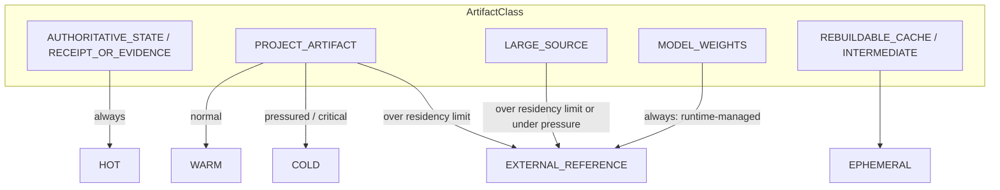

# Storage Flexibility V1

Status: **IMPLEMENTED (policy layer)**. Module: `src/pados/lifecycle/storage_flexibility.py`. Tests:
`tests/lifecycle/test_storage_flexibility.py`.

## Principle

Locally, PADOS keeps **small authoritative state**, not **large duplicated assets**.

| Keep locally (HOT/WARM) | Avoid duplicating locally |
|---|---|
| metadata, identities, hashes, manifests | model weights (the runtime owns them) |
| receipts, small evidence, audit references | large binary sources, datasets, archives |
| Task / Project semantic state, indexes | duplicated artifacts (deduplicated by identity) |
| policy state, capability profiles | rebuildable caches, large intermediate outputs |

PADOS Core is not bound to MinIO, S3, a NAS, Google Drive, one filesystem or one cloud vendor. Storage is a
replaceable placement behind a small protocol.

## What already existed (reused, not duplicated)

| Concern | Single authority | Storage Flexibility uses it as |
|---|---|---|
| Byte identity | SHA-256 content address of `ObjectStore` (`state_proof/object_store.py`) | the only identity (`content_id`), re-verified on every read from every backend |
| Semantic truth / acceptance | `StateProofService.commit_result` (CAS) | untouched: placement never commits, accepts or rejects anything |
| Retention vocabulary | `pados.lifecycle.retention` (R0–R3, `DataKind`) | unchanged |
| Physical deletion | operator-invoked `pados.lifecycle.purge` (`plan_purge` / `apply_purge`, tombstones) | eviction is only a recommendation that feeds it |
| Model identity | `ModelCatalog` (identity only) + node `ModelManifest` (digest, availability) | weights are referenced, never stored |

A static test asserts that the module imports no state-proof, DB, router, capability, threading, asyncio or
subprocess code, and calls no delete or commit operation (`NO_SECOND_CAS`).

## Tiers and classes

`choose_tier(class, size, budget, pressure)` is pure and deterministic. Authoritative state is always HOT
(local).

## Backends (`StorageBackend` protocol)

| Backend | Holds bytes | Use |
|---|---|---|
| `ObjectStoreBackend` | yes | the existing local `ObjectStore`, same layout and identity (no new byte store) |
| `MemoryBackend` | yes | tests; the shape of an external disk / NAS / S3-compatible adapter |
| `ReferenceBackend` | **no** | bytes another system keeps (model runtime, archive). `put` is refused; reads go through a caller-supplied fetch and are hash-verified |

The same logical artifact keeps the same immutable identity on every backend. A backend is never trusted for
identity: mismatched bytes raise `STORAGE_CONTENT_HASH_MISMATCH`. Placement locations are opaque labels. Query
strings, credentials and signatures are refused (`STORAGE_LOCATION_NOT_A_SAFE_LABEL`), so a presigned URL can
never be recorded.

## Deduplication

The `PlacementIndex` is an immutable value: every operation returns a new index. It maps one physical artifact
(digest) to many logical references. Storing identical bytes again adds a reference and never writes a second
copy. Removing a reference never implies deleting bytes. Deletion keeps the existing purge semantics.

## Budgets (configuration, never hard-coded disk sizes)

`StorageBudget`: `min_free_bytes` (reserve), `pressured_free_fraction`, `critical_free_fraction`,
`project_budget_bytes` (per project), `cache_budget_bytes`, `max_local_residency_bytes`. When a field is unset,
no limit is configured.

## Graceful storage pressure

`pressure_of(observation, budget)` → `NORMAL` / `PRESSURED` / `CRITICAL`. Unknown free space counts as
`PRESSURED`: PADOS avoids growth and deletes nothing on that basis.

| Pressure | Effect |
|---|---|
| NORMAL | normal placement; cache trimmed only when over its budget |
| PRESSURED | advice: avoid large local downloads, prefer resident resources, externalize large artifacts, reduce cache retention. Large sources go to EXTERNAL_REFERENCE. Eviction plan: rebuildable data only |
| CRITICAL | new non-authoritative local writes are refused (`STORAGE_CRITICAL_LOCAL_WRITE_REFUSED`); authoritative state is still written. Advice adds "prefer remote capability where policy permits". Eviction plan: rebuildable data plus local copies that have a **verified replica** elsewhere |

Storage pressure never changes authorization or semantic truth, and never silently deletes governed evidence.
`PressureAdvice` is advisory and carries no authority. A planner may use it only inside its existing feasible
set.

## Eviction (recommendation only)

`plan_eviction(...)` returns an `EvictionPlan` with `deletes=False` and `authority="NONE"`. The following are
never candidates:

- authoritative state, receipts and audit evidence;
- unique, unreplicated artifacts.

To act on a plan, the operator uses the existing purge path (`plan_purge` / `apply_purge`, exact plan hash,
tombstone ledger).

## Not in V1

- Concrete NAS, S3 or cloud adapters (the protocol is ready; no dependency was added).
- Persisting the placement index. In V1 it was an in-memory value. V1+ persists it as a registered persistence
  point (see below).
- Wiring storage pressure into the planner. The signal exists, and the planner contract stays unchanged until
  a reviewed integration.

## V1+ (configured policy, persisted index, reporting, model locations, pressure snapshot)

Status: **IMPLEMENTED**. Modules: `src/pados/lifecycle/storage_policy.py`, `storage_index.py`,
`storage_report.py`, additions to `storage_flexibility.py` and `src/pados/resources/models.py`. Tests:
`tests/lifecycle/test_storage_flexibility_v1plus.py`, `tests/resources/test_model_artifact_location.py`.
V1+ adds no authority, no second CAS and no deletion path.

### Configured policy (`storage_policy.py`)

`load_storage_policy(path)` reads a validated document (`.json` or `.toml`, schema
`pados.lifecycle.storage-policy.v1`):

| Section | Holds |
|---|---|
| `budget` | `StorageBudget`: `local_budget_bytes` (total bytes PADOS holds locally), `min_free_bytes` (reserve), `project_budget_bytes` (per project), `cache_budget_bytes`, `max_local_residency_bytes`, and the pressure fractions |
| `retention` | R0/R1 windows for the existing `RetentionPolicy` (`r0_hours`, `r1_days`, `explicit_override`) |
| `class_data_kinds` | optional override of which existing `DataKind` an `ArtifactClass` is retained as |

An unset path gives the defaults: no size limit, only the conservative pressure fractions. Everything else
fails closed with `StoragePolicyError`: unknown schema, unknown or duplicate keys, a string or boolean where a
number belongs (never coerced), non-finite numbers, an R1 window outside 7-30 days without
`explicit_override`, an unsupported file format, or a missing configured file.

### Tier and class retention (no second vocabulary)

Each `ArtifactClass` maps onto a `DataKind` of the Lifecycle catalog, so its R0..R3 class and purge rule come
from `pados.lifecycle.retention`:

| ArtifactClass | Default DataKind | Retention | Allowed overrides |
|---|---|---|---|
| AUTHORITATIVE_STATE | `ARTIFACT_HASH` | R3 | R3, R2 |
| RECEIPT_OR_EVIDENCE | `EXECUTION_RECEIPT_SUMMARY` | R3 | R3, R2 |
| PROJECT_ARTIFACT | `ACTIVE_ARTIFACT` | R2 | R2, R3 |
| LARGE_SOURCE | `PROJECT_SOURCE` | R2 | R2, R3 |
| MODEL_WEIGHTS | `ARTIFACT_HASH` (identity only) | R3 | none |
| REBUILDABLE_CACHE | `CACHE_ENTRY` | R0 | R0 only |
| INTERMEDIATE | `RAW_INTERMEDIATE_OUTPUT` | R0 | R0 only |

Authoritative state, receipts and unique work never expire by age. The EPHEMERAL tier is R0 only
(`STORAGE_EPHEMERAL_TIER_IS_R0_ONLY`). A mapping onto the rejected-payload kind is refused, because only the
rejection path may purge payloads.

### Local budget and pressure

With `local_budget_bytes` configured, `pressure_of(observation, budget, local_bytes)` applies the same
fractions to the budget headroom and returns the worse of the disk and the budget condition.
`StorageManager.store` refuses a non-authoritative local write that would exceed the budget
(`LOCAL_STORAGE_BUDGET_EXCEEDED`). Authoritative state and receipts are still written.

### Persisted placement index (`storage_index.py`)

`PlacementIndexStore` is a registered persistence point: `storage_placement_index` in
`pados.lifecycle.inventory`, `DataKind.STORAGE_PLACEMENT_INDEX` (R2, `HUMAN_DECISION_ONLY`, not authoritative).
The document is content-free (digests, sizes, classes, tiers, backend ids, safe labels). It passes
`assert_minimized` with an explicit schema and is written with the existing operational-store helpers (store
lock, owner-only temporary file, fsync, atomic replace). It carries `index_digest`, the canonical SHA-256 of
its body.

A load validates everything or refuses it: wrong shape or schema, a digest mismatch
(`STORAGE_INDEX_TAMPERED`), an invalid entry, a duplicate digest or a non-canonical document. References and
locations must be safe labels; free text is refused on save. The embedded digest only detects accidental or
naive edits. A caller that needs tamper evidence keeps the digest returned by `save` elsewhere and passes it as
`expected_digest`. Losing the index loses no bytes, because bytes keep their content address.

### Reporting and eviction (`storage_report.py`)

- `placement_location(path)` adds the index to `build_locations(extra=...)`. Accounting measures it, never
  estimates it as purge-eligible, and `scopes_from_locations` treats it as protected.
- `placement_report(index, ...)` gives counts and bytes by tier, class, retention class and backend:
  local bytes, referenced-only bytes and the bytes deduplication saved. It names no reference, file or
  location.
- `recommend_eviction(...)` annotates each `plan_eviction` candidate with its `DataKind`, retention class,
  purge rule and route: `PLAN_PURGE_R0_R1_SCOPE` (an operator-approved `plan_purge` / `apply_purge` over a
  deletable scope) or `HUMAN_DECISION_ONLY`. It deletes nothing (`deletes=False`, `authority="NONE"`).
  Protected classes are never candidates.

### Model artifact location (`ModelCatalog`)

`ModelArtifactLocation` records, per registered model, where the artifact bytes live as an external
reference: `backend_id`, an optional safe `label`, `managed_by = RUNTIME` and an optional content digest. It is
never a path to copy, a URL, a query string or a credential. It authorizes, installs, downloads and selects
nothing. Locations are kept beside the descriptions (`ModelCatalog.locate`, `artifact_location`), so
`profile_digest` never depends on them. A catalog without locations produces the same document and
`catalog_digest` as before; a test pins those digests to the values the previous catalog code computed.
Moving the bytes to another backend changes the location only, never the model identity.

### Advisory pressure snapshot

`pressure_snapshot(observation, budget, index=...)` returns a frozen `StoragePressureSnapshot`: the pressure,
the `PressureAdvice`, the observed numbers, `authority="NONE"`, `affects_authorization=false`,
`affects_semantic_state=false` and `recommendation_only=true` (each fixed by its type). It is pure and changes
nothing. The planner, router and scheduler are unchanged and do not read it yet. A later reviewed integration
may use it only inside its existing feasible set.

### Still not done

- Concrete NAS, S3 or cloud adapters (the protocol is ready).
- Wiring the snapshot into planning (signal only).
- A `Settings` field for the policy path. Today the caller passes the path to `load_storage_policy`.
- Stronger tamper evidence than a self-digest plus a caller-held expected digest (for example a keyed MAC or
  an external anchor).
