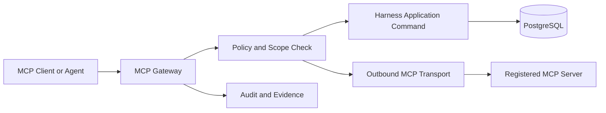

# PADOS vNext MCP Boundary

Status: `PROPOSED`.

## Two explicit directions

| Direction | Role | Rule |
| --- | --- | --- |
| Outbound MCP Client Gateway | PADOS or a dispatched agent calls a registered external MCP Server | Gateway evaluates project, execution, tool and data scopes before every call |
| Inbound PADOS MCP Server | Claude Code, Codex, IDE or another MCP client calls PADOS tools | Each tool maps to a Harness application command and never directly writes PostgreSQL |

## Common controls

- Authentication: OAuth, API key, service identity or approved local transport identity.
- Authorization: user/role, project, execution, tool and data-classification scopes.
- Transports: HTTP and STDIO initially; future MCP transport requires a registered adapter.
- Audit: caller, correlation ID, command/tool, input/output hashes, policy decision, timestamp and result.
- Safety: rate limit, timeout, response size bounds, failure classification, secrets redaction and high-risk human approval.
- Write capability: explicit per-tool scope; no implicit write authority from read access.

MCP is neither the Harness nor a bypass around it.
