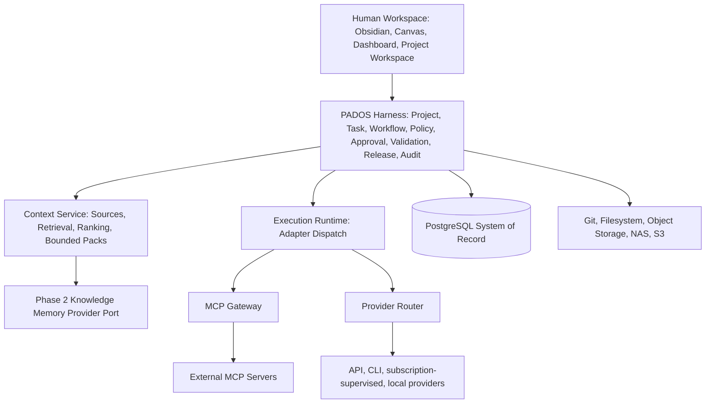

# PADOS vNext Target Architecture

Status: `PROPOSED`.

## Architectural invariants

1. PADOS Harness is the sole Control Plane.
2. PostgreSQL is the System of Record for all governed operational state.
3. Context Service builds bounded, ranked, project-scoped Context Packs; it does not control agents.
4. Knowledge Memory is a Phase-2 provider capability, never a control-plane authority.
5. Obsidian is a Human Workspace and projection layer, not a database, runtime or memory engine.
6. MCP is an integration layer. Inbound MCP commands invoke Harness application commands; they never write PostgreSQL directly.
7. Every execution uses a registered adapter and a policy-evaluated execution mode.
8. Approval, validation, release and evidence are mandatory governed aggregates, not provider assertions.

## Bounded contexts

| Context | Owns | May not own |
| --- | --- | --- |
| Identity and Access | users, roles, permissions, project membership | provider secrets or execution behavior |
| Project and Workspace | project identity, roots, workspace registration | task execution status |
| Task and Workflow | task versions, state machine, orchestration | provider-specific SDK behavior |
| Execution Runtime | dispatch records, adapter invocation, execution steps | approval decisions |
| Provider Governance | provider registration, token source, quota, routing decision | domain state transitions |
| Context Service | sources, lineage, retrieval, ranking, immutable packs | knowledge-provider implementation or agent control |
| Artifact, Validation and Evidence | hash/version, validation outcomes, evidence graph | mutable provider truth |
| Release and Audit | release manifests, audit events, retention | direct external writes |
| MCP Integration | MCP registry, transport, scopes and tool-call audit | direct database writes |
| Knowledge Memory Phase 2 | provider-neutral metadata and capability discovery | control-plane ownership |

## Logical data rules

- Current state is mutable only through an authorized Harness command; history is append-only.
- Task/Execution current state and their event history are both persisted; events explain state but do not replace state reads.
- Context Pack, Evidence and Release Manifest are immutable and content-addressed.
- Artifact bodies reside in storage; PostgreSQL owns identifiers, hashes, lineage, classification, retention and access policy.
- Secrets are represented only by secret references, never by values in tables, logs, packs, embeddings or Markdown projections.
