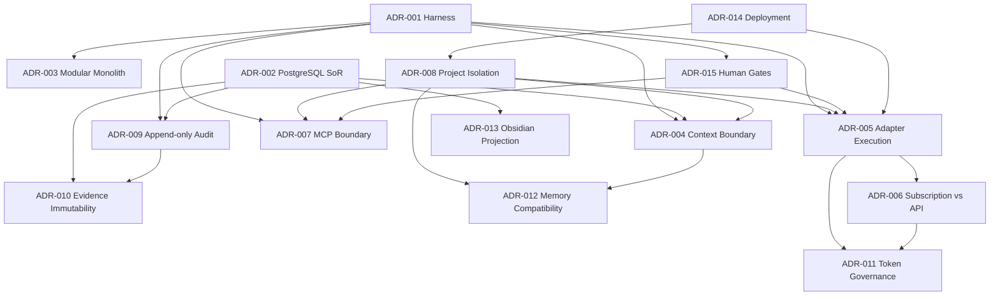

# PADOS vNext ADR Dependency Graph

Status: `RECOMMENDATION ONLY`.

## Interpretation

- **Foundational**: ADR-001, ADR-002, ADR-003, ADR-004, ADR-008 and ADR-013.
- **Execution dependent**: ADR-005 depends on Harness and isolation; ADR-006 and ADR-011 require provider evidence before operational use.
- **Phase 2 dependent**: ADR-012 depends on Context boundary and project isolation; it must not block Phase A/B.
- **P6.11 protective dependencies**: ADR-001, ADR-004, ADR-008, ADR-009, ADR-010 and ADR-015 require preservation of current P6.11 transitions, events, evidence and human gates.
- **Evidence-sensitive**: ADR-006 needs subscription/provider automation evidence; ADR-011 needs usage, billing and credential-governance evidence; ADR-007 needs threat-model evidence before implementation.
