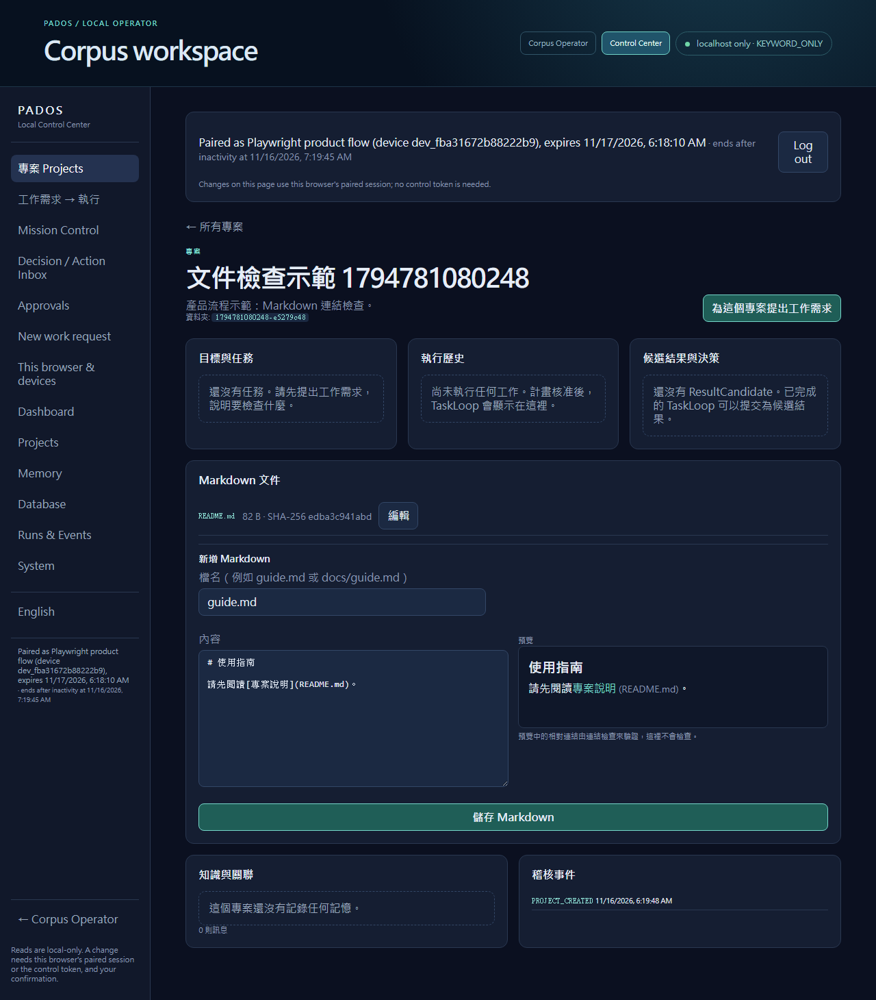
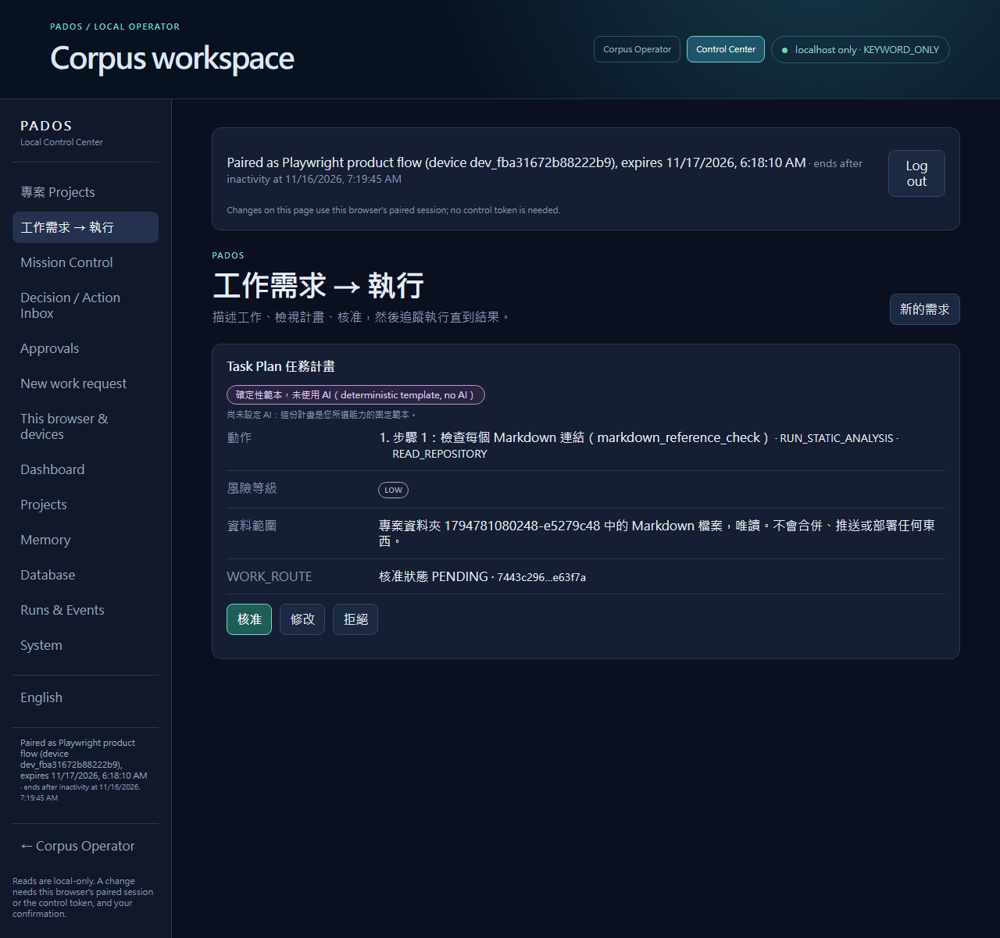
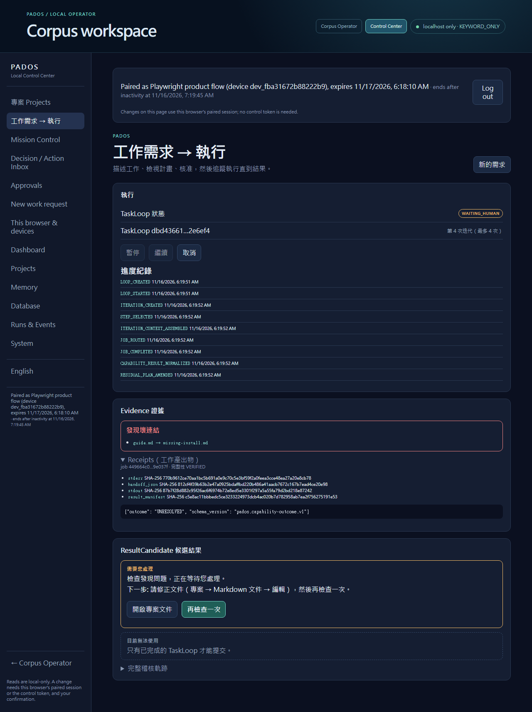
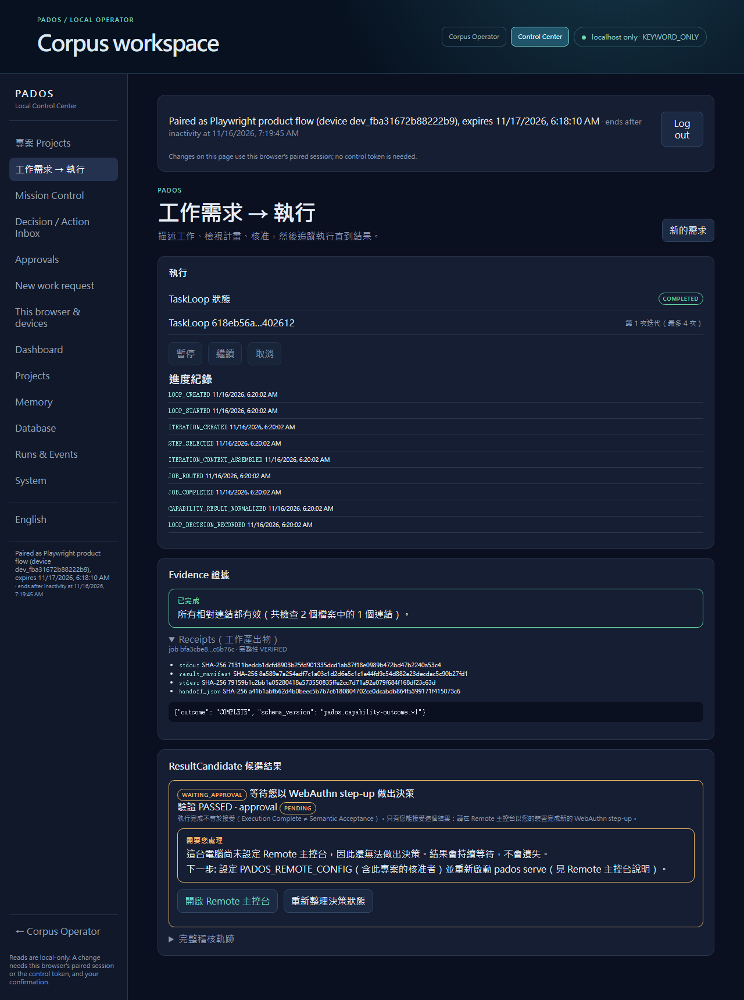
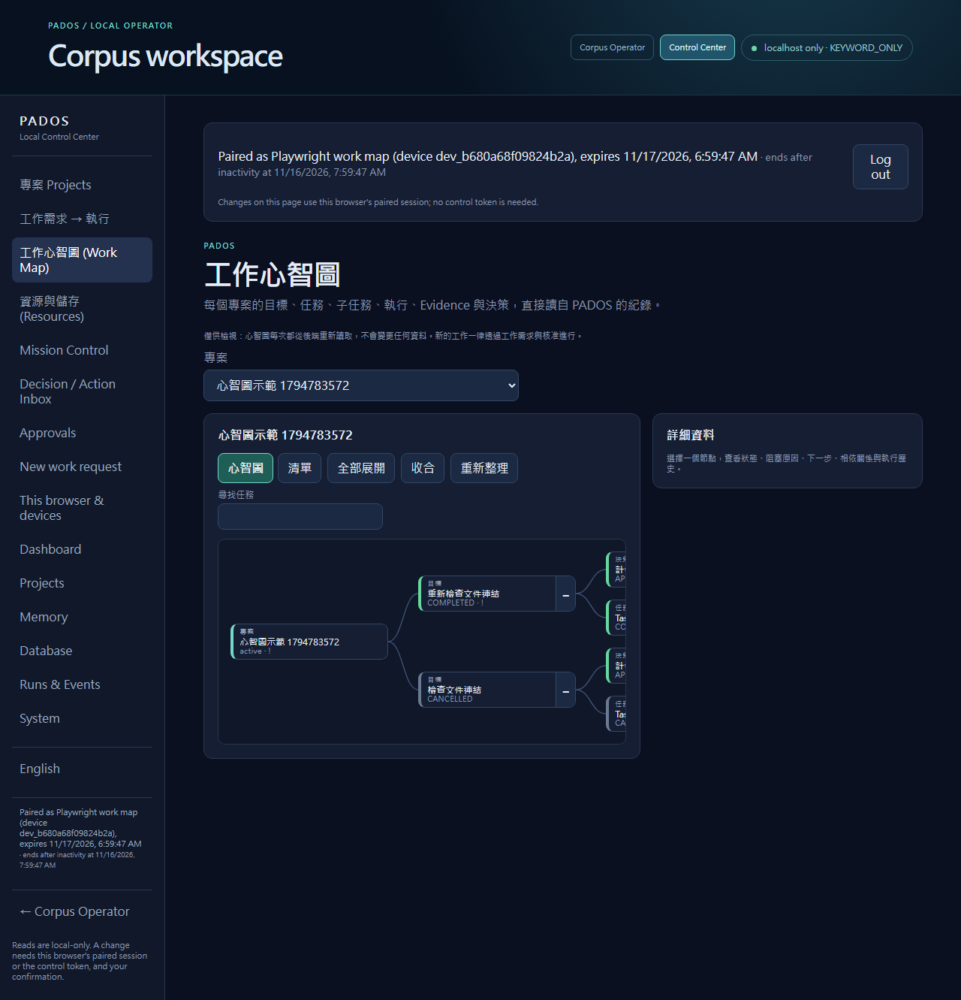

# PADOS 操作手冊（zh-TW，本機單人、受監督、合成或非敏感資料）

適用版本：draft PR #35 → #36 → #37 → #38 的整合堆疊（`feat/runtime-provider-setup-20261116`，`1af18ba`）。
這些 PR **尚未合併**。本手冊只描述目前存在、而且有證據的功能。每一節都標示證據等級：

| 標示 | 意義 |
| --- | --- |
| **LIVE** | 在真實程序上跑過：真實 `pados serve`、真實 PostgreSQL 18、真實瀏覽器（Playwright），Windows 11。資料是合成的。 |
| **SYNTHETIC** | 只用測試替身驗證過（假的 OIDC 簽發者、模擬的閘道、軟體 WebAuthn 驗證器、單元測試或 mocked Playwright）。 |
| **NOT_LIVE_VALIDATED** | 程式存在，但從未對真實的外部系統驗證過。 |
| **NOT_IMPLEMENTED** | 不存在。 |

本手冊引用的 LIVE 證據來自各 PR 分支在整合前的版本（身分 `eaeb9f4`／`298d32f`、產品流程 `aafb2a8`、心智圖與資源
`3e0b25a`、閘道模擬 `ee72d89`、本機模型 `e0e0765`），以及在整合版本 `1af18ba` 上的啟動器實測。整合版本的完整
Windows／Linux 驗證結果記錄在 [PRODUCT_ACCEPTANCE_REPORT_2026-11-16.md](PRODUCT_ACCEPTANCE_REPORT_2026-11-16.md) 的
FINAL VALIDATION 一節。

既有環境（舊 `main` `9b975a9`）在合併後如何升級：[LOCAL_CUTOVER_RUNBOOK_zh-TW.md](LOCAL_CUTOVER_RUNBOOK_zh-TW.md)。
讓 `PADOS-First-Dogfood` 使用 AI 還缺哪些步驟：[DOGFOOD_AI_ENABLEMENT_zh-TW.md](DOGFOOD_AI_ENABLEMENT_zh-TW.md)。

整體狀態：**production NOT_READY**。這是本機、單人、受監督的工具，不是多人或對外服務。
Microsoft Entra ID / Google 單一登入與企業 AI 閘道都是 **NOT_LIVE_VALIDATED**；Windows Hello 與 Windows SID 綁定是
**NOT_IMPLEMENTED**。

三條不變的規則，貫穿整本手冊：

- **執行完成 ≠ 接受結果**（Execution Complete ≠ Semantic Acceptance）。只有您在 Remote 主控台以新的 WebAuthn step-up
  做出決策，結果才會被接受。
- **可連線 ≠ 可用於受治理的工作**。模型有回應只代表「已連線」。
- **配對的瀏覽器權限比 control token 小**。它可以做日常工作，但不能接受結果，也不能改管理層級的設定。

---

## 1. 第一次啟動

### 1.1 一次性的準備（只做一次）

依照 [LOCAL_USAGE_GUIDE.md](LOCAL_USAGE_GUIDE.md) 第 1 節完成：建立 `.venv`、`pados init`（產生 `.env` 與
`runtime\local\control.token`）、在 `.env` 填好 PostgreSQL 的主機、連接埠與密碼、建立三個資料庫並執行 migration、
`cd web; npm ci`。

要使用瀏覽器配對，請自己在 `.env` 加上（或改成）：

```text
PADOS_IDENTITY_SESSIONS_ENABLED=true
```

預設是 `false`（是否預設開啟仍是 Owner 決策）。關閉時一切照舊：Control Center 會要求貼上 control token。

### 1.2 用啟動器啟動（Windows）

在 checkout 資料夾的 PowerShell 視窗：

```powershell
.\scripts\windows\Start-PADOS.ps1 -DryRun   # 只檢查並印出計畫，不啟動任何東西
.\scripts\windows\Start-PADOS.ps1           # 啟動
```

或在 cmd.exe／捷徑使用 `scripts\windows\Start-PADOS.cmd`（參數相同）。

啟動器 `scripts/windows/Start-PADOS.ps1` 會依序：

1. 找到 checkout 根目錄；
2. 檢查 `.venv\Scripts\python.exe`、`npm.cmd`、`web\node_modules`、`.env`，缺什麼就印出**一行修正指令**；
3. 從 `.env` 只讀取非機密設定（資料庫主機／連接埠、API 主機、配對開關、允許的 Origin），**絕不印出密碼或 token**；
4. 檢查 PostgreSQL 是否接受連線、連接埠是否空著（預設 API `8088`、網頁 `5173`，可用 `-ApiPort`／`-WebPort` 改）；
5. 以子程序啟動 `pados serve` 與 Vite 開發伺服器，記錄檔在 `runtime\logs\`（`pados-serve.*.log`、`pados-web.*.log`），
   程序編號在 `runtime\local\pados-launcher.json`；
6. 等待 API 連接埠確實由它啟動的 `pados serve` 持有、`/health/ready` 回覆 PADOS 的就緒報告，且網頁連接埠由它啟動的
   Vite 持有；然後開啟 `http://127.0.0.1:5173/operator.html`，並在配對開啟時印出配對方法。
   啟動途中任何失敗或按 Ctrl+C，都會停止它已啟動的程序；畫面只顯示封閉的錯誤代碼，詳情請看記錄檔。

它**絕不**執行 `pados init`、**絕不**修改 `.env` 或資料庫。

| 指令 | 作用 |
| --- | --- |
| `-Status` | 顯示啟動器啟動的程序是否還在、`/health/ready` 的結果與未正常的檢查項目 |
| `-Stop` | 只停止這個啟動器啟動的程序（依 PID 檔，並核對啟動時間；若 PID 已被別的程式重用，會顯示 `PID_REUSED` 而不停止它） |
| `-NoBrowser` | 不自動開瀏覽器 |
| `-ReadyTimeoutSeconds 120` | 等待就緒的上限（預設 90 秒） |

啟動成功時的輸出（節錄）：

```text
[ OK ] PostgreSQL accepts connections at 127.0.0.1:5432
[ OK ] Port 8088 is free
[INFO] Started pados serve (PID ...) and the web dev server (PID ...); waiting...
[ OK ] API ready: OK (chat_provider=NOT_CONFIGURED (CHAT_PROVIDER_UNCONFIGURED))
[ OK ] PADOS is running. Control Center: http://127.0.0.1:5173/operator.html
```

`chat_provider=NOT_CONFIGURED` 是正常的：預設沒有設定聊天模型。

證據：啟動器的 Pester 測試（Windows PowerShell 5.1，34 項通過，含以假子程序、路徑含空白與中文字的啟動流程）與一次完整的本機啟動測試（臨時 runtime、私有
PostgreSQL、自己的連接埠：啟動、就緒、`operator.html` 回應 200、配對碼、經網頁 Origin 完成配對、重複啟動被拒、
`DEFAULT_CONTROL_TOKEN_REFUSED` 的拒絕與清理、`-Stop`），見
[PRODUCT_ACCEPTANCE_REPORT_2026-11-16.md](PRODUCT_ACCEPTANCE_REPORT_2026-11-16.md)。**LIVE（單一主機）。**

> 舊的 `Start-PADOS-Web.ps1`（checkout 根目錄）仍然存在，但它會自動換到別的連接埠並在前景執行；新的啟動器不猜測、
> 會說明原因，並可用 `-Stop` 停止。

---

## 2. 配對登入（一次，之後不用再貼 token）

1. 開一個 PowerShell 視窗，在 checkout 資料夾執行（啟動器會印出這一行，連接埠已代入）：

   ```powershell
   .\.venv\Scripts\pados.exe device pair --base-url http://127.0.0.1:8088
   ```

   輸出 `Pairing code: XXXXX-XXXXX` 與到期時間。這個指令用 `runtime\local\control.token` 向本機 API 申請配對碼；
   token 本身不會被印出。
2. 在瀏覽器的 `operator.html` 按右上角 **Control Center**，左側選 **This browser & devices**，在
   **Pair this browser** 輸入配對碼（可填裝置名稱），按 **Pair this browser**。
3. 成功後，頁面上方會顯示 **Paired as …（device dev_…）, expires …**，並說明
   「Changes on this page use this browser's paired session; no control token is needed.」

之後重新整理頁面會自動恢復工作階段；**不需要再複製 control token**。

| 規則 | 數值 |
| --- | --- |
| 配對碼 | 約 50 位元、5 分鐘有效、只能用一次 |
| 工作階段 | 絕對期限 24 小時、閒置 2 小時（`PADOS_IDENTITY_SESSION_TTL_SECONDS`／`PADOS_IDENTITY_IDLE_TIMEOUT_SECONDS`） |
| Cookie | HttpOnly、SameSite=Strict；瀏覽器儲存空間不會有任何 token |
| 失敗太多次 | 配對暫停約 60 秒（`PAIRING_RATE_LIMITED`），您的配對碼不會因此作廢 |

已配對的瀏覽器只能呼叫允許清單上的 Control Center 路由；其他一律回覆 `SESSION_SCOPE_DENIED`
（例如 `/context/assemble`、記憶寫入、投影渲染、AI 提供者的「編輯設定」）。

證據：Windows 11 身分 E2E（`eaeb9f4`）26 PASS、0 FAIL；VMware Linux（`298d32f`）23 PASS、2 項略過（PowerShell 5.1
是 Windows 專屬；VM 的瀏覽器版本比 lock 舊）；live Playwright 配對。**LIVE。** 最小權限允許清單（A2）、Windows 身分資料夾
權限（A3）與 SSO 介面（A4）只在整合測試、Vitest 與 mocked Playwright 中驗證（**SYNTHETIC**）：上述 live E2E 都早於 A2–A4。
整合後版本的真實執行結果見驗收報告的 FINAL VALIDATION 一節。

單一登入（SSO，Entra ID／Google）：只有在設定了 `PADOS_IDENTITY_OIDC_CONFIG` 時，**This browser & devices** 才會出現
**單一登入 (SSO)** 區塊。它從未對真實租戶驗證過（**NOT_LIVE_VALIDATED**），請勿用於正式環境；設定方式見
[../identity/OIDC_SETUP.md](../identity/OIDC_SETUP.md)。Windows Hello 與 Windows SID 綁定：**NOT_IMPLEMENTED**。

---

## 3. 建立專案

左側 **專案 Projects** → 頁面下方 **新專案**：填 **名稱**（必填）與 **說明（選填）**，按 **建立專案**。

PADOS 會在核准的工作區（`.env` 的 `PADOS_PRODUCT_WORKSPACE_ROOT`，`pados init` 預設為
`runtime\local\workspace`）為它建立資料夾，並初始化專案的 ScopeVersion。**您不需要輸入任何路徑或 UUID。**



常見錯誤：`PROJECT_NAME_TAKEN`（同名）、`PROJECT_FOLDER_EXISTS`（工作區已有同名資料夾）、
`PROJECT_PROOF_SCOPE_UNAVAILABLE`（專案已存，但 proof 資料庫沒有回應；確認資料庫後再按一次，不會重複建立）。

證據：產品流程 E2E 步驟 `project_created_with_name_only`。**LIVE。**

---

## 4. 新增 Markdown

專案頁 → **Markdown 文件** → **新增 Markdown**：

- **檔名**：例如 guide.md 或 docs/guide.md（只接受 `.md`，最多兩層資料夾）；
- **內容**：右側 **預覽** 即時顯示；
- 按 **儲存 Markdown**，頁面顯示 `已儲存 guide.md（SHA-256 …）`。

既有檔案用 **編輯** 修改。若有人在您開啟後改過它，儲存會被拒絕（`DOCUMENT_CHANGED`），請重新載入，絕不會默默覆蓋。
單檔上限 256 KiB；內容看起來像金鑰或登入資訊時會被拒絕（`DOCUMENT_CONTENT_REJECTED`）。

證據：E2E 步驟 `markdown_added_inside_the_project`。**LIVE。**

---

## 5. 送出任務（工作需求）

專案頁按 **為這個專案提出工作需求**，或左側 **工作需求 → 執行**：

1. **專案**：選擇專案；
2. **PADOS 要使用的能力**：目前可用的是
   **檢查 Markdown 連結（RUN_STATIC_ANALYSIS · markdown_reference_check）**，它只讀取專案資料夾中的 Markdown，
   確認每個相對連結都指向存在的檔案，絕不修改檔案。
   「摘要文件」「修改 Markdown」顯示為 **需要 AI 模型或變更計畫，這裡尚未設定。**
3. **標題**、**要做什麼**；
4. 按 **產生計畫**。

---

## 6. 檢視計畫與核准

**Task Plan 任務計畫** 會標示 **確定性範本，未使用 AI**：這是您所選能力的固定範本，不是模型產生的。
您會看到 **動作**、**風險等級**、**資料範圍**（例如「專案資料夾中的 Markdown 檔案，唯讀。不會合併、推送或部署任何東西。」）
與 **WORK_ROUTE** 的 **核准狀態 PENDING**。



按 **核准**、**修改** 或 **拒絕**。核准之前不會執行任何東西；拒絕時「計畫已被拒絕，沒有執行任何工作」。
一個核准只能被一次執行使用（`APPROVAL_CONSUMED`），也會過期（`APPROVAL_EXPIRED`）。

證據：E2E 步驟 `plan_approved_and_run`。**LIVE。**

---

## 7. 執行與 Evidence

核准後，**執行** 區塊顯示 **TaskLoop 狀態**、**第 N 次迭代（最多 4 次）**、**暫停**／**繼續**／**取消** 與
**進度紀錄**（`LOOP_CREATED`、`JOB_ROUTED`、`JOB_COMPLETED` 等事件）。

**Evidence 證據**：

- 連結都正確：「所有相對連結都有效（共檢查 … 個檔案中的 … 個連結）」；
- 有壞連結：**發現壞連結**，列出 `檔案 → 目標`，TaskLoop 停在 **WAITING_HUMAN**，提示
  「檢查發現問題，正在等待您處理。」請按 **開啟專案文件** 修正，再按 **再檢查一次**；
- **Receipts（工作產出物）**：stdout、stderr、handoff、result manifest，每一份都有 SHA-256，並標示完整性 VERIFIED。



只有 **COMPLETED** 的 TaskLoop 能提交為候選結果（`RESULT_CANDIDATE_REQUIRES_COMPLETED_TASKLOOP`）。這是治理規則，
所以示範流程是「修正 → 再檢查 → COMPLETED → 提交」。

證據：E2E 步驟 `evidence_names_the_broken_link`、`unfinished_check_cannot_become_a_candidate`、
`fixed_document_check_completes`。**LIVE。**

---

## 8. 提交候選結果與 WebAuthn 決策

TaskLoop 為 COMPLETED 時，按 **提交候選結果**。**ResultCandidate 候選結果** 顯示 **驗證 PASSED**、狀態
**WAITING_APPROVAL**，與 **等待您以 WebAuthn step-up 做出決策**：

> 執行完成不等於接受（Execution Complete ≠ Semantic Acceptance）。只有您能接受這個結果：請在 Remote 主控台以您的裝置
> 完成新的 WebAuthn step-up。



按 **開啟 Remote 主控台** 做決策，回來後按 **重新整理決策狀態**。Control Center 沒有「接受」按鈕：配對的瀏覽器與
control token 都不能接受結果（`RESULT_ACCEPTANCE_REQUIRES_STEP_UP`）。

**尚未設定 Remote 主控台或沒有已註冊裝置時：**

| 頁面顯示 | 意義與下一步 |
| --- | --- |
| 這台電腦尚未設定 Remote 主控台，因此還無法做出決策。結果會持續等待，不會遺失。 | 設定 `PADOS_REMOTE_CONFIG`（含此專案的核准者）並重新啟動 `pados serve`，見 [../remote/REMOTE_OPERATIONS_V1.md](../remote/REMOTE_OPERATIONS_V1.md)。 |
| 此專案的核准者尚未註冊 WebAuthn 裝置。結果會持續等待。 | 在 Remote 主控台（Presence）註冊裝置，把它加入 Remote 設定中的核准者，再做決策。 |

候選結果會一直是 PENDING，直到有人以 step-up 做出決策；不會因為等待而被接受或遺失。

證據：E2E 步驟 `result_candidate_waits_for_approval`、`step_up_cannot_be_bypassed_by_session`（核准仍為 PENDING）。
**LIVE。** 真正以 WebAuthn step-up 接受並經單一 CAS 提交（ScopeVersion 0 → 1）由 `local_dogfood_e2e.py` 驗證，
使用的是軟體驗證器（**SYNTHETIC** 裝置，非手機或硬體金鑰）。「沒有已註冊裝置」這個狀態只有單元測試（**SYNTHETIC**）。

---

## 9. 工作心智圖（Work Map）

左側 **工作心智圖 (Work Map)**，選擇專案。結構是 專案 → 目標 → 任務 → 子任務 → 執行 → Evidence → 決策。

- **心智圖**／**清單** 兩種檢視；**全部展開**、**收合**、**重新整理**、**尋找任務**；
- 點節點，右側 **詳細資料** 顯示 **狀態**、**阻塞原因**、**下一步**、**相依於**、**執行歷史**；
- **從這裡提出工作需求** 走一般的工作需求與核准流程；**開啟這次執行**；**在 Remote 主控台決策**。



心智圖是**僅供檢視**的投影：每次都從後端重新讀取，不會變更任何資料；只有記錄了 APPROVE 決策，結果才會顯示為已接受。

證據：`work_map_resources_e2e.py --playwright` 18/18 PASS（候選結果在圖上仍為 WAITING_STEP_UP，後端一致為 PENDING）。
**LIVE。** 設計見 [../architecture/WORK_MAP_AND_RESOURCES_V1.md](../architecture/WORK_MAP_AND_RESOURCES_V1.md)。

---

## 10. 連接 AI（AI 模型與連線）

左側 **AI 模型與連線 (Providers)**。頁面頂端的規則：**可連線 ≠ 可用於受治理的工作**。

每個提供者有兩層狀態：

| 第一層：連線狀態 | 第二層：治理狀態（每個模型） |
| --- | --- |
| 已連線 Reachable／無法連線 Unreachable／部分異常 Degraded／已停用 Disabled／尚未檢查 Not checked | 已授權並測量 Authorized & measured／已測量但未授權／已測量，但證據不適用於此環境（未授權）／未授權（尚未測量） |

### 10.1 本機 Ollama

**Ollama (PADOS settings)** 來自 `OLLAMA_BASE_URL`（預設 `http://127.0.0.1:11434`），不需另外設定。按 **測試連線**
看到模型清單與摘要值（身分）。

- **測量**：用 Stage B 腳本在這台機器、這個執行環境版本上量測模型（`scripts/stage_b/`），結果登錄到模型目錄
  （`PADOS_MODEL_CATALOG`）。執行環境版本不同時會顯示 `RUNTIME_VERSION_NOT_MEASURED`（證據不適用）。
- **授權**：compute-node 註冊（`PADOS_COMPUTE_NODES_CONFIG`）明確列出這個模型。
- 只有「已測量的設定檔與此模型（相同摘要值）、這個執行環境與這台裝置相符，**且**註冊已授權」才是
  **已授權並測量**。其他情況都只是非權威的觀察結果；任何模型輸出都不會被自動接受。

證據：Windows 11、Ollama 0.40.16，`qwen3:8b` 重新量測（M2 identity PASS、M3 profile 已登錄但未授權），再以既有的
M4.1 受治理流程跑一次真實任務 `REAL_TASK_DOGFOOD=PASS`：臨時的明確授權（之後移除）、receipt SUCCEEDED、
驗證器 5/5 欄位、`semantic_authority` NONE、沒有提交給 CAS。**LIVE（單一主機、合成資料）。**

以上是在臨時 runtime 上的 TEST 結果。您自己的環境要讓專案使用模型，還需要逐步完成目錄、量測、登錄、授權與聊天提供者設定，
每一步的狀態見 [DOGFOOD_AI_ENABLEMENT_zh-TW.md](DOGFOOD_AI_ENABLEMENT_zh-TW.md)。

### 10.2 企業 AI 閘道

閘道介接器（`enterprise_gateway`）以私有合約檔描述 API，金鑰只以**環境變數名稱**引用，資料分級預設上限 PUBLIC，
RESTRICTED 絕不送出，預設不執行（只做健康檢查與模型探索）。

- **編輯設定**（端點或閘道合約）只接受 control token：已配對的瀏覽器會收到 `SESSION_SCOPE_DENIED`。
  **啟用**／**停用** 與 **測試連線** 可以用配對的瀏覽器。
- **以探測訊息測試** 只送出一句固定、不含敏感內容的句子（PUBLIC），回答標示為 **非權威觀察結果**。
- **斷路器**：連續失敗後 **開啟** 暫停呼叫，之後 **半開** 允許一次試探，成功即 **關閉**。

狀態：**ADAPTER_READY**、**SIMULATED_E2E_PASS**（模擬閘道 15/15，含 live Playwright）、
**ENTERPRISE_LIVE_NOT_VALIDATED**（從未呼叫過真實的企業閘道）。取得 VPN 後，請 Owner 依
[../local-compute/ENTERPRISE_GATEWAY_LIVE_ACCEPTANCE.md](../local-compute/ENTERPRISE_GATEWAY_LIVE_ACCEPTANCE.md)
逐步驗收，**驗收時不要送出任何內部文件**。

---

## 11. 資源與儲存（Resources）

左側 **資源與儲存 (Resources)**，按 **重新量測**。每個數字都標示 **來源**、單位與 **量測時間**。

- **已量測**：有數值、來源與時間；**估計值** 另外標示。
- **UNKNOWN（未量測）**：PADOS 沒有量到，所以不顯示數字，而是顯示 **未量測原因**。這不是錯誤，也不是零。例如：
  - 模型常駐記憶體 `MODEL_RUNTIME_NOT_CONFIGURED`：沒有把提供者設定為本機 Ollama；
  - Token／上下文用量、模型執行時間 `NO_MEASURED_MODEL_EXECUTION`：還沒有受測量的模型執行；
  - 儲存大小趨勢 `HISTORY_NOT_RECORDED`：PADOS 不記錄歷史大小樣本，只顯示目前大小。
- **儲存預算**：未設定 `PADOS_STORAGE_POLICY` 時沒有位元組預算，但磁碟門檻仍適用：可用空間 ≤ 15% 警告、≤ 5% 嚴重
  （或預算使用 ≥ 85%／≥ 95%）。量不到磁碟可用空間時，PADOS 會視為有壓力。
- **清理計畫（預覽）**：只是預覽，**不會刪除任何東西**。Evidence、決策、稽核紀錄與唯一副本永遠不會被列為清理對象。
  頁面顯示 **需要 Owner 授權**：PADOS 沒有受治理且可復原的清理動作，任何刪除都必須由 Owner 在此頁面之外決定。

證據：E2E 步驟 `resources_summary_measures_or_says_unknown`、`cleanup_plan_is_a_preview_that_protects_evidence`。
**LIVE。**

---

## 12. 登出與撤銷裝置

| 動作 | 位置 | 效果 |
| --- | --- | --- |
| 登出這個瀏覽器 | **This browser & devices** → **Log out** | 只結束這個瀏覽器的工作階段；裝置仍列在清單上，直到被撤銷 |
| 撤銷裝置 | **Devices** 表格中該裝置的 **Revoke** | 結束該裝置的所有工作階段 |
| 用指令列出／撤銷 | `.\.venv\Scripts\pados.exe device list --base-url http://127.0.0.1:8088`，`... device revoke dev_<16 位十六進位> --base-url ...` | 同上（需要 control token 檔） |
| 結束所有工作階段 | `pados init --force` 產生新的 control token | 所有工作階段立即失效；之後要用新的 token 並重新配對 |
| 完全停用配對 | `.env` 設 `PADOS_IDENTITY_SESSIONS_ENABLED=false` 並重新啟動 | 工作階段立即停止，回到貼 token 的方式 |

證據：E2E 步驟 `logout_revokes_current_session`、`device_revoke_kills_other_devices_session`、
`cli_device_list_and_revoke`、`control_token_rotation_ends_sessions`、`idle_expiry`。**LIVE。**

---

## 13. 疑難排解（錯誤碼白話說明）

### 啟動器

| 代碼 | 白話說明 | 怎麼做 |
| --- | --- | --- |
| `CHECKOUT_NOT_FOUND` | 從這裡往上找不到 PADOS checkout | 在 checkout 裡執行，或加 `-Root <資料夾>` |
| `[FAIL] Python virtual environment …` | 還沒建立 `.venv` | 照印出的 `py -3.12 -m venv .venv; …` 那一行 |
| `[FAIL] Web dependencies web\node_modules` | 還沒安裝網頁相依套件 | `cd web; npm ci; cd ..` |
| `[FAIL] Settings file .env` | 還沒執行過 `pados init` | 自己執行一次 `.\.venv\Scripts\pados.exe init`（啟動器不會代勞） |
| `[FAIL] PostgreSQL accepts connections …` | 資料庫沒在執行，或 `.env` 的主機／連接埠不對 | 啟動 PostgreSQL 服務，或修正 `PADOS_DB_HOST`／`PADOS_DB_PORT` |
| `PORT_IN_USE` | 連接埠被別的程式占用（會列出程式名稱與 PID） | 若是 PADOS，用 `-Status`／`-Stop`；否則換 `-ApiPort`／`-WebPort` |
| `ALREADY_RUNNING` | 這個啟動器已經在這裡啟動過 PADOS | `-Status` 查看，`-Stop` 停止 |
| `BACKEND_START_REFUSED` | `pados serve` 拒絕啟動，後面附上原因 | 依原因處理（見下方 `DEFAULT_CONTROL_TOKEN_REFUSED` 等） |
| `HEALTH_NOT_READY` | 在時限內 `/health/ready` 沒有就緒，列出未正常的檢查 | 看 `runtime\logs\pados-serve.err.log`；常見是 `operational_database` 未 migration |
| `WEB_START_FAILED` | Vite 沒有啟動 | 看 `runtime\logs\pados-web.err.log` |
| `ORIGIN_NOT_ALLOWED`（啟動器警告） | 您用的網頁連接埠不在 `PADOS_IDENTITY_ALLOWED_ORIGINS` | 自己把 `http://127.0.0.1:<WebPort>` 加到 `.env`，或用預設 5173 |
| `PID_REUSED` | PID 檔中的編號已屬於別的程式 | 不會被停止；確認後可刪除 `runtime\local\pados-launcher.json` |
| `PID_FILE_INVALID` | PID 檔損壞，啟動器不會依它停止或啟動任何東西 | 在工作管理員確認沒有這個 checkout 的 python／node 在執行，再刪除該檔 |
| `PORT_TAKEN_BY_OTHER` | 啟動途中，連接埠被別的程式搶先占用 | 找出並關閉該程式，或換連接埠；已啟動的部分會自動停止 |
| `START_INTERRUPTED`／`START_NOT_STABLE` | 啟動途中發生例外或被中斷／子程序回應後立即結束 | 已啟動的部分會自動停止；看 `runtime\logs\` |
| `NOT_PADOS_HEALTH`（在 `HEALTH_NOT_READY` 中） | API 連接埠上回應的不是 PADOS | 確認沒有別的服務；看 `runtime\logs\pados-serve.err.log` |
| `SETTING_INVALID` | `.env` 的 `PADOS_DB_PORT` 不是數字 | 自己修正 `.env` |
| `ROOT_PATH_UNSUPPORTED` | checkout 路徑含有 `%` 或 `!`，cmd.exe 會把它們展開 | 把 checkout 放到不含這兩個字元的資料夾 |

### 配對與工作階段

| 代碼 | 白話說明 | 怎麼做 |
| --- | --- | --- |
| `IDENTITY_DISABLED` | 伺服器沒開啟瀏覽器配對 | `.env` 設 `PADOS_IDENTITY_SESSIONS_ENABLED=true` 後重新啟動；或改用 control token |
| `PAIRING_CODE_INVALID` | 配對碼不對 | 檢查後重打，或再執行 `pados device pair` |
| `PAIRING_CODE_EXPIRED` | 配對碼超過 5 分鐘 | 再執行 `pados device pair` |
| `PAIRING_RATE_LIMITED` | 失敗太多次，暫停約一分鐘 | 等一分鐘再試 |
| `SESSION_REQUIRED` | 這個瀏覽器還沒配對 | 配對，或改用 control token |
| `SESSION_EXPIRED`／`SESSION_REVOKED` | 工作階段過期、已登出或裝置被撤銷 | 重新配對 |
| `CSRF_INVALID` | 安全檢查失敗（例如頁面開太久） | 頁面會重新讀取工作階段；確認後再做一次 |
| `ORIGIN_NOT_ALLOWED` | 伺服器不接受這個頁面的來源 | 用 `http://127.0.0.1:5173` 或 `:8088` 開啟，或把來源加入允許清單 |
| `SESSION_SCOPE_DENIED` | 配對的瀏覽器不能做這項管理層級的操作 | 在這台電腦用 control token（pados CLI，或在未配對的瀏覽器輸入 token） |
| `DEVICE_NOT_FOUND`／`DEVICE_LIMIT` | 裝置不存在／已達裝置上限 | 重新整理清單；撤銷不用的裝置 |
| `IDENTITY_STORE_INSECURE` | 身分資料夾可被其他帳號讀寫，PADOS 拒絕使用 | 刪除 `runtime\local\identity`（所有工作階段失效），PADOS 會以僅限擁有者的權限重建 |
| `IDENTITY_SECURE_COOKIE_REQUIRED` | 在非 loopback 位址使用工作階段 | 本機使用時保持 `PADOS_API_HOST=127.0.0.1` |
| `BASE_URL_NOT_LOOPBACK`／`CONTROL_TOKEN_FILE_NOT_FOUND` | `pados device …` 的網址不是本機，或找不到 token 檔 | 用 `--base-url http://127.0.0.1:<ApiPort>`，在 checkout 資料夾執行 |

### 專案、文件與執行

| 代碼 | 白話說明 | 怎麼做 |
| --- | --- | --- |
| `PROJECT_NAME_TAKEN`／`PROJECT_FOLDER_EXISTS` | 名稱或資料夾已存在 | 換一個名稱 |
| `PROJECT_WORKSPACE_ROOT_NOT_CONFIGURED` | 沒有核准的工作區 | 這台電腦執行過 `pados init` 的 `.env` 才有 `PADOS_PRODUCT_WORKSPACE_ROOT` |
| `PROJECT_PROOF_SCOPE_UNAVAILABLE`／`TASK_ENVELOPE_SCOPE_VERSION_UNAVAILABLE` | proof 資料庫沒有回應 | 確認 PostgreSQL 與 proof 資料庫，再按一次 |
| `PROJECT_ROOT_OUTSIDE_WORKSPACE` | 專案資料夾不在核准的工作區（例如用舊 CLI 建立） | 文件為唯讀 |
| `DOCUMENT_EXISTS`／`DOCUMENT_CHANGED` | 檔案已存在／開啟後被改過 | 用「編輯」；重新載入後再改 |
| `DOCUMENT_PATH_INVALID`／`DOCUMENT_PATH_OUTSIDE_PROJECT`／`DOCUMENT_TOO_LARGE` | 檔名不合規則／位置在專案外／超過 256 KiB | 依頁面說明修正 |
| `PROJECT_CONTENT_REJECTED`／`DOCUMENT_CONTENT_REJECTED` | 內容像金鑰或登入資訊 | 移除後再存 |
| `APPROVAL_CONSUMED`／`APPROVAL_EXPIRED` | 核准已被用過或過期 | 建立新的需求 |
| `LOOP_TRANSITION_REFUSED`／`LOOP_NOT_RUNNING` | 目前狀態不允許這個操作 | 暫停中就按「繼續」；已結束就建立新的執行 |
| `RESULT_CANDIDATE_REQUIRES_COMPLETED_TASKLOOP` | 只有 COMPLETED 才能提交 | 修正問題、再檢查一次 |
| `RESULT_ACCEPTANCE_REQUIRES_STEP_UP` | 接受結果必須在 Remote 主控台做 WebAuthn step-up | 開啟 Remote 主控台 |
| `WRITE_OUTCOME_UNKNOWN` | 變更可能已套用，也可能沒有 | 重新整理確認後再試，不要盲目重送 |
| `NETWORK_ERROR` | 網頁連不到 PADOS | `-Status` 檢查；`pados serve` 是否在執行 |
| `DEFAULT_CONTROL_TOKEN_REFUSED` | `.env` 用的是公開的預設 token | 在新的 checkout 執行 `pados init`（已有 `.env` 時要 `--force`，會產生新 token） |
| `WORKTREE_IMPORT_PATH_MISMATCH` | 在不是安裝 CLI 的那個 checkout 執行 | 到訊息指出的 checkout 執行 |

### AI 提供者與閘道

| 代碼 | 白話說明 |
| --- | --- |
| `GATEWAY_NETWORK_UNREACHABLE`／`GATEWAY_DNS_FAILED` | 連不到閘道所在網路（VPN 或私有網路沒連） |
| `GATEWAY_TLS_FAILED` | 安全連線失敗（憑證不受信任、過期或主機不符） |
| `GATEWAY_AUTH_NOT_CONFIGURED`／`GATEWAY_AUTH_FAILED` | 金鑰的環境變數沒設定（什麼都沒送出）／閘道拒絕金鑰 |
| `GATEWAY_MODEL_NOT_LOADED`／`GATEWAY_MODEL_NOT_FOUND`／`GATEWAY_MODEL_IDENTITY_MISMATCH` | 模型未載入／不存在／以別的模型回答（回答已捨棄） |
| `GATEWAY_RATE_LIMITED`／`GATEWAY_TIMEOUT`／`GATEWAY_UNAVAILABLE`／`GATEWAY_CONNECTION_LOST` | 限流／逾時／伺服器端錯誤／連線中斷 |
| `GATEWAY_CIRCUIT_OPEN` | 連續失敗後暫停呼叫；稍後或按「測試連線」試探 |
| `GATEWAY_WRITE_OUTCOME_UNKNOWN` | 請求可能已送達但沒有回應；PADOS 不會自動重送，請先確認 |
| `GATEWAY_NOT_AUTHORIZED_FOR_EXECUTION` | 未啟用執行，或資料分級高於上限 |
| `PROVIDER_DISABLED`／`PROVIDER_PROJECT_NOT_IN_SCOPE` | Owner 已停用此提供者／專案不在它的範圍內 |
| `RUNTIME_VERSION_NOT_MEASURED`／`DEVICE_NOT_MEASURED` | 執行環境版本或裝置與測量時不同：需要重新量測 |
| `MODEL_NOT_AUTHORIZED` | 已測量，但沒有 compute-node 註冊授權 |
| `PROVIDER_SETTINGS_CONTAIN_KEY_VALUE` | 欄位看起來像金鑰值；只能填環境變數名稱 |
| `PROVIDERS_SETUP_REVISION_CONFLICT` | 設定在這段期間被改過；重新載入後再套用 |

---

## 14. 回退

由輕到重：

1. **停止**：`.\scripts\windows\Start-PADOS.ps1 -Stop`。資料都在 PostgreSQL 與專案資料夾，下次啟動照舊。
2. **關閉配對**：`.env` 設 `PADOS_IDENTITY_SESSIONS_ENABLED=false`，重新啟動。要同時作廢已發出的工作階段，刪除
   `runtime\local\identity\sessions.json`，或以 `pados init --force` 換新 token（之後所有地方都要用新 token）。
3. **AI 提供者**：在頁面按 **停用**，或刪除 `runtime\local\providers.json`（`PADOS_PROVIDERS_SETUP`）；沒有設定項目的
   提供者行為與以前完全相同。
4. **程式回退**：依 #38 → #37 → #36 → #35 的順序 revert（各 PR 都沒有資料庫 migration）。啟動器與本手冊可以獨立 revert。
5. 從舊版升級後要回到舊版：依 [LOCAL_CUTOVER_RUNBOOK_zh-TW.md](LOCAL_CUTOVER_RUNBOOK_zh-TW.md) 的 (i) 回退。
6. 舊的手動方式仍可用：`pados serve` 加 `cd web; npm run dev`，或根目錄的 `Start-PADOS-Web.ps1`。

接受過的結果（ScopeVersion）不會因為以上任何一步而改變；回退只影響之後的操作方式。
