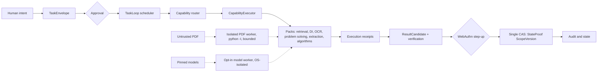

# PADOS final engineering report (November 2026)

Canonical `main`: **`7043c63dae4796c0c62cfff2d94ec9f20cdc26fc`**, the merge of PR #33.
Release baseline: [`PADOS_LOCAL_DOGFOOD_BASELINE_2026-11-14.md`](PADOS_LOCAL_DOGFOOD_BASELINE_2026-11-14.md).
Dashboard: [`docs/architecture/pados-release-baseline-2026-11-14.html`](../architecture/pados-release-baseline-2026-11-14.html).

**Verdict: local-supervised dogfood evidence passes on Windows 11 and VMware Linux, with explicit residuals.
Production is NOT_READY.**

This report separates three evidence classes:

- **GitHub-confirmed.** Results visible on GitHub: Actions runs, PR state, merge commits and alerts.
- **Machine-local.** Windows 11 host and VMware Ubuntu 24.04 runs. Their raw records are kept outside the
  repository, bound to an exact commit, and are summarized here.
- **Synthetic.** Results on synthetic data or test authenticators, as opposed to real hardware or production
  traffic.

No completion percentage or cost saving is claimed, because neither has a measurable denominator.

## 1. Objectives and delivered scope

| Objective (owner authorization, 2026-11-14) | Delivered |
| --- | --- |
| Release-candidate review and risk disposition | PR #26 sign-off matrix. Owner decisions are recorded on PR #26. Human code review of the cumulative diff was **not performed** and is recorded as such. |
| Atomic merge of the stack (#20–#25) with a merge commit | `1fd5608`: tree `d7982f0` identical to RC `202df5c`; all 109 RC commits are on `main`. |
| Close superseded PRs with references | #21, #22, #24 and #25 were closed with the merge SHA. GitHub auto-marked #20 as merged. Branches were kept. |
| Post-merge validation bound to the merge commit | §6.1 |
| Security and dependency remediation in separate PRs | #27–#33 (§7) |
| Product stabilization of the local dogfood journey | Validated by the executable E2E on both platforms (§5). No new Core architecture. |
| Documentation, architecture, roadmap, final checkpoint | PR #34: this report, the baseline, the dashboard and the diagrams. |
| Not authorized: production deployment, weakening controls, protected tags, proprietary assets | None of these was done. |

## 2. Engineering timeline and PR history

| Date (UTC) | PR | Change | Size (+/−, files) | Landed on `main` |
| --- | --- | --- | --- | --- |
| 2026-11-01 → 11-14 | #20 | Operability OP-001…010: context and error envelope, runtime lane gate, health, deadlines, idempotency, metrics | +9,742/−145, 106 | via #26 |
| 2026-11-03 → 11-14 | #21 | Local single-user usability fixes from a real walkthrough | +2,183/−55, 43 | via #26 |
| 2026-11-10 → 11-14 | #22 | Runtime hardening: R19-3 timing residuals, health cost, startup stop race | +1,293/−65, 22 | via #26 |
| 2026-11-14 | #24 | Document intelligence: dense retrieval, RRF, cross-encoder rerank (SHADOW), evidence pack | +4,577/−12, 32 | via #26 |
| 2026-11-14 | #25 | DI hardening: private verified model copy, subprocess worker, OCR raster candidate, artifact-read fix (DI-9) | +1,660/−9, 21 | via #26 |
| 2026-11-14 11:21 | **#26** | Atomic release candidate (#20–#25 at `202df5c`, 109 commits) | +19,426/−257, 195 | **`1fd5608`** |
| 2026-11-14 12:04 | #27 | N-1: step-up guard and existence probes resolve on the `search_path` | +179/−8, 9 | `2515c8a` |
| 2026-11-14 12:24 | #30 | certifi 2026.10.23 (critical emSign advisory), Mako 1.4.3 | +8/−8, 4 | `282d343` |
| 2026-11-14 12:32 | #28 | vite 7.3.7, source-map-js 1.2.2 (dev toolchain) | +6/−6, 1 | `0f8d00b` |
| 2026-11-14 12:48 | #29 | `.env` and control token written owner-only from creation | +132/−4, 2 | `f397135` |
| 2026-11-14 13:12 | #32 | P2-11: pypdf 6.21.4; untrusted PDFs parsed in a bounded isolated worker | +1,371/−130, 12 | `95dcaa0` |
| 2026-11-14 13:28 | #31 | Security register (docs) | +53/−0, 1 | `f6db272` |
| 2026-11-14 13:37 | #33 | OS-enforced isolation for the opt-in model worker | +1,285/−57, 8 | **`7043c63`** |
| 2026-11-15 | #34 | Documentation closure (this report) | docs only | see PR |

The 109 RC commits fall on 8 calendar days (2026-11-01, -02, -03, -04, -07, -09, -11, -14).

## 3. Current architecture

The authority layer is unchanged and singular: one `TaskEnvelope` intake, one scheduler (TaskLoop), one capability
router, one `CapabilityExecutor`, one CAS (StateProof). Packs add capabilities through manifests. Their outputs are
candidates and never authority.

Reproducible diagram sources:

- `docs/architecture/public/release-baseline-2026-11-14.mmd`: merge topology, evidence and owner gates.
- `docs/architecture/public/capability-status-2026-11-14.mmd`: capabilities by evidence class.
- `docs/architecture/public/authority-chain.mmd`: the authority chain.

## 4. Capability inventory

Evidence classes:

- **R (real runtime):** Windows 11 and VMware Linux, real processes, real PostgreSQL.
- **S (synthetic):** synthetic data, a software authenticator, or a deterministic stand-in.
- **X (experimental, opt-in, off by default).**
- **D (disabled or SHADOW).**
- **B (blocked or NOT_VALIDATED).**

| Area | Capability / component | Class | Notes |
| --- | --- | --- | --- |
| Authority | TaskEnvelope, approvals, TaskLoop, router, executor, receipts, verification, ResultCandidate, CAS, audit | R | Exercised by the E2E on both platforms; frozen |
| Governance | WORK_ROUTE approval lifecycle (TTL, revoke, single use) | R | E2E negatives pass |
| Governance | WebAuthn step-up for result acceptance; control token cannot decide it | R + S | Real P-256 software authenticator, not a hardware key; holds in non-default schemas (#27) |
| Core capabilities | `READ_REPOSITORY`, `SEARCH_CONTEXT`, `SUMMARIZE`, `CLASSIFY_REQUEST`, `GENERATE_DOCUMENT_DRAFT`, `MODIFY_MARKDOWN`, `MODIFY_CODE`, `RUN_STATIC_ANALYSIS`, `RUN_TESTS`, `RUN_MIGRATIONS`, `BUILD_RELEASE`, `AUDIT_RELEASE`, `CREATE_ARTIFACT` | R for the deterministic probe path (`RUN_STATIC_ANALYSIS` / `markdown_reference_check` in the E2E); others contract-tested | Model-backed variants need a configured provider (none by default) |
| Retrieval pack | `PASSAGE_RETRIEVAL` (BM25), `PASSAGE_RETRIEVAL_EMBEDDING`, `PASSAGE_RERANK` | R | Synthetic corpus |
| Document intelligence | `PASSAGE_RETRIEVAL_DENSE`, `PASSAGE_RANK_FUSION`, `PASSAGE_EVIDENCE_PACK` | R (synthetic corpus) | Pinned bge-small model, live on both platforms |
| Document intelligence | `PASSAGE_RERANK_CROSS_ENCODER` | D (SHADOW default) | ACTIVE only through a separate operator-chosen template (DI-7) |
| Document intelligence | DI-1 subprocess model worker with OS isolation | X | #33; never enabled by `src/` or `scripts/` |
| OCR pack | text layer (`DOCUMENT_OCR` via pypdf), structure, layout, tables, figures | R on Linux (isolated); B on Windows (fails closed, R19-3) | — |
| OCR pack | Raster path (pypdfium2 + Tesseract) | X | Live only in a Docker image on the VM (earlier round) |
| Corpus / URL ingest / enterprise extraction | Untrusted PDF parsing | R | Isolated bounded worker (#32); no kernel memory cap on Windows |
| Problem solving pack | `STRUCTURED_PROBLEM_SOLVING` (8D profile), `ROOT_CAUSE` | S | Deterministic drafter only; model claim provider NOT_VALIDATED |
| Extraction pack | `EXTRACT_TABLE_DATASET`, `STRUCTURED_EXTRACTION` | S | Contract and refusal tests |
| Algorithms pack | `INFER_CONCEPT_STATES`, `RESULT_EXPLANATION` | S | Contract-level |
| Reference / intelligence | `REFERENCE_DIGEST`, `SUMMARIZE_PIPELINE_EVIDENCE` | S | — |
| Local inference | Ollama under a measured binding | R (measured, Stage B) | Output never reaches the CAS (R19-6) |
| Product Loop | `/product-loop/*` | D | `PADOS_PRODUCT_LOOP_ENABLED=false` by default |
| Optional runtimes | REA, OpenMAIC, AI-Scientist-v3 | B | Adapters tested against fakes only |
| Remote Ops / PWA | Mobile intents to the Home Base | R on VMware (virtual authenticator, earlier round) | Hardware passkey UAT pending |
| Operability | Health (`/health/live`, `/health/ready`), metrics, trace context, lane gate | R | Loopback only |

## 5. Local-supervised dogfood journey (validated synthetic, both platforms)

`scripts/dogfood/local_dogfood_e2e.py` ran with 25/25 steps PASS at `1fd5608` and at `7043c63`, on both Windows 11
and VMware Linux. The steps are:

- install and init;
- migrations, doctor, and refusal of the default token;
- health;
- project creation;
- approval before routing;
- planning and execution;
- receipts;
- ResultCandidate verification;
- fail-closed negatives;
- WebAuthn step-up;
- the single CAS (ScopeVersion 0 → 1);
- restart persistence and acceptance after restart.

Per-step mapping: baseline §4.

## 6. Test evidence

### 6.1 At the RC merge commit `1fd5608`

| Source | Lane | Result |
| --- | --- | --- |
| GitHub-confirmed | pr-ci (linux, windows, macos), CodeQL ×2, secret scan and CI policy | PASS |
| GitHub-confirmed | rc-ci: packaging linux-x64 and win32-x64, fresh-install migration gate, PostgreSQL integration, manifest | PASS |
| Machine-local Windows 11 | 18 CI gates; E2E; PostgreSQL gate; Pester; Playwright | PASS |
| Machine-local Windows 11 | Full pytest | **FAIL, baseline-identical:** 4924 tests, 163 failures, the same test ids as RC `202df5c` and baseline `205543a` |
| Machine-local VMware | 19 gates; E2E; Linux full pytest | PASS (19/19) |

### 6.2 At final `main` `7043c63`

| Source | Lane | Result |
| --- | --- | --- |
| GitHub-confirmed | pr-ci, security (CodeQL, secret scan) | PASS |
| GitHub-confirmed | rc-ci (packaging, migrations, PostgreSQL integration, manifest) | PASS |
| Machine-local Windows 11 | Gates, E2E, PostgreSQL gate, Pester, Playwright | PASS (34 of 35 steps exit 0) |
| Machine-local Windows 11 | Full pytest | **FAIL, baseline-identical:** 5024 tests (+100 new), 163 failures, the same ids as `1fd5608` |
| Machine-local VMware r1 | 19 gates, E2E | **18/19**, E2E PASS. `frontend` failed with `ENOTCACHED` for vite 7.3.7: the offline npm cache predated #28. Kept as evidence. |
| Machine-local VMware r2 | 19 gates, E2E | **PASS 19/19**, E2E PASS (npm cache seeded, same SHA, unmodified chain) |

### 6.3 Per follow-up PR (GitHub-confirmed)

Every follow-up PR passed all 11 PR checks at its merged head. The table below lists the extra evidence each one
had. Merges needed updates against `main` because branch protection is strict.

| PR | Extra evidence | Defects caught before merge |
| --- | --- | --- |
| #27 | rc-ci at head; local PostgreSQL gate with all 6 suites (D1 42 passed, 0 skipped) | none material (one P3 applied) |
| #28 | rc-ci at an earlier head | none |
| #29 | — | review P2 (control token written through an existing file) fixed; one public-export CI failure fixed |
| #30 | rc-ci (hashed wheel locks installed) | none |
| #32 | rc-ci at the final head | review P2-A (transient failures recorded as malformed) and P2-B (120 s slot wait) fixed |
| #33 | VM run with real pinned models (142 passed) | review P2-1 (kill after reap) fixed |

### 6.4 Runtime lane gate (tool verdict, not reinterpreted)

| Target | `202df5c` (RC) | `1fd5608` | `7043c63` |
| --- | --- | --- | --- |
| local-supervised-dogfood | READY | NOT_READY | NOT_READY |
| production | NOT_READY | NOT_READY | NOT_READY |

At both `main` commits the only failing required lane is `github-ci`. The required `dependency review` job runs only
on pull requests and is skipped on a push to `main`. All other required checks succeeded. The gate rule was not
changed. The decision is OWNER-GATE-1.

## 7. Security remediation and accepted residuals

| Finding | Action | State |
| --- | --- | --- |
| N-1: step-up guard could switch off in a non-default schema | #27 | Fixed; tested in both schemas, and the tests fail on the old code |
| P2-11: in-process pypdf on untrusted input; 14 pypdf advisories | #32 | Fixed. Remaining: no kernel memory cap on Windows (P2) |
| certifi emSign (critical), Mako | #30 | Fixed |
| vite and source-map-js advisories (dev) | #28 | Fixed |
| `.env` and control-token write-through (CodeQL #8, adjacent) | #29 | Fixed |
| Model worker: only a polled memory cap; network denial in-process only | #33 | Kernel caps when opted in. Windows network isolation is open (owner decision) |
| tinypool, vitest, @vitest/mocker (dev only) | — | Accepted residual until the vitest 4 major upgrade (owner decision) |
| CodeQL #1, #2, #3, #4, #7 | Triaged false positives (security register) | Owner dismisses in GitHub |
| P2-01, P2-03, P2-05, N-2 | — | Accepted for local use (baseline §6) |

Alert counts:

- **Dependabot:** 27 → 19 open. The 14 remaining pypdf alerts point at a manifest that pins 6.21.4 since #32, and
  they await Dependabot's next scan. The other 5 are the vitest group.
- **CodeQL:** 5 open, all triaged.
- **Secret scanning:** 0.

## 8. Readiness

- **Local-supervised dogfood:**
  - Every lane that executes code passes on `7043c63`: GitHub CI, rc-ci, Windows gates and E2E, VMware 19/19 and
    E2E.
  - The Windows full suite is baseline-identical FAIL (R19-3), which this target does not require.
  - The lane-gate tool reports NOT_READY only because of OWNER-GATE-1. **Status: PASS_WITH_EXPLICIT_RESIDUALS.**
- **Production: NOT_READY.**
  - These lanes are NOT_VALIDATED: local-model governed acceptance (R19-6), measured LLM execution at this commit,
    REA, OpenMAIC and AI-Scientist-v3.
  - These items are open: Windows kernel containment for the workers, Windows worker network isolation,
    signed/CI-produced runner records (P2-01), non-loopback exposure policy (P2-03), and hardware passkey UAT.
  - Legal review is pending before any public release.

## 9. Technical debt and prioritized roadmap

1. **Owner decisions** (unblock everything below):
   - OWNER-GATE-1;
   - OWNER-WIN-JOB;
   - OWNER-NET;
   - OWNER-DI: DI-1, DI-4, and the embedder pin RAM. The measured peak is 1220–1240 MiB against `max_ram_mb`
     1024 at the pin's own maximum batch.
   - OWNER-DEP: vitest 4, CodeQL dismissals, GAP-1.
2. **Windows containment:**
   - a Job Object for the PDF and OCR workers (closes the P2-11 residual and part of R19-3);
   - then the OCR pack on Windows.
3. **Test debt:**
   - #33 P2-2: kernel-level probes for the ptrace, io_uring and pidfd denials and the RLIMIT_AS refusal on Linux;
   - #33 P2-3: replace a source-text test;
   - #32 P3s: an output-overflow kill test, and a test of concurrent BUSY.
4. **Operations:**
   - reserve or move the VM chain's fixed ports (OPS-PORTS);
   - VM internet (OWNER-VM);
   - keep the VM npm cache and wheelhouse in step with lock changes; r1 above shows why.
5. **Product:**
   - expose the document workflow in the UI and API;
   - a real-corpus retrieval benchmark before any rerank ACTIVE default (DI-7);
   - an embedding cache when measured need appears (DI-3).
6. **Production track:**
   - a governed model-output path (R19-6);
   - signed runner records;
   - hardware passkey UAT;
   - public-release legal review.

## 10. Performance (measured; sources cited)

| Change | Measurement | Source |
| --- | --- | --- |
| DI-9: size-bounded artifact read (`ccc14e8`, Core file, semantics unchanged) | 7 governed BM25 → evidence tasks on Windows: 4.72 s → 0.34 s total (14×). Median BM25 stage 238 → 19 ms; evidence stage 434 → 21 ms (Linux: 11–13 ms) | `docs/packs/document_intelligence/EVALUATION_PROTOCOL.md` |
| Retrieval quality (20 synthetic queries, identical on both platforms) | nDCG@5: BM25 0.436, dense 0.569, RRF 0.475, hybrid + cross-encoder 0.573. The reranker lowered keyword Success@1 from 0.67 to 0.44, so it stays SHADOW. | `docs/packs/document_intelligence/BENCHMARK_2026-11-14.md` |
| Stage latency (median; Windows vs Linux; synthetic) | Whole task 3164 vs 869 ms; dense 1841 vs 718 ms; rerank (20 candidates) 569 vs 124 ms | same |
| Windows full-suite wall time | 551 s at `1fd5608` vs 427 s at `7043c63` (both on the same host and profile) | junit `time` fields. A single run each with host load not controlled, so this is not claimed as an improvement. |

## 11. Development efficiency and reuse

Measured denominators only:

- **RC stack:**
  - 109 commits;
  - +19,426/−257 lines in 195 files;
  - 8 commit days.
- **Follow-up round:**
  - 7 PRs, merged between 12:04 and 13:37 UTC on 2026-11-14;
  - +3,034/−213 lines in 37 files (sum of the per-PR figures in §2);
  - 100 new tests in the Windows full suite (4924 → 5024).
- **Reuse, document intelligence round:**
  - 1,828 new pack source lines;
  - about 17,200 existing, already-validated lines exercised unchanged by the slice;
  - so about 9 reused lines per new line (`docs/architecture/PADOS_ARCHITECTURE_AND_PROGRESS_2026-11-14.md` §11).
  - Not built, because they already existed: an OCR framework, a reranker framework, an RRF implementation, a
    vector database, a new scheduler, router or CAS.
- **Review yield:**
  - 4 independent review runs covering 6 of the 7 follow-up PRs (#27; #28, #29 and #30 together; #32; #33). The
    release lead reviewed #31 (docs).
  - 4 P2 defects fixed before merge (#29 token, #32 P2-A and P2-B, #33 P2-1), each with a test that fails on the
    previous code;
  - 0 P0 or P1 findings.
- **Rework:**
  - 2 CI cycles lost to the public-export `secret_like` rule (#29, #32);
  - 1 VMware rerun for the stale offline npm cache.

## 12. Reproducible installation, startup and recovery

- **Install and start:** see `docs/product/QUICKSTART.md`, and on Windows `docs/product/LOCAL_USAGE_GUIDE.md`. The
  sequence is:
  1. `pip install -c requirements.lock -e ".[dev]"`
  2. `pados init`
  3. the lane migrations
  4. `pados doctor`
  5. `pados serve` (binds 127.0.0.1 only)
  6. the web console
- **Verify end to end:** `scripts/dogfood/local_dogfood_e2e.py`. On Windows, use `--pg-bin`, which needs no
  password.
- **Recovery:**
  - Restart persistence is proven by the E2E.
  - `pados project initialize-proof-scope` repairs an interrupted proof-scope initialization.
  - Backups: `BACKUP_RESTORE.md`. Operations: `OPERATIONS.md` and `TROUBLESHOOTING.md`.
- **Rollback:**
  - `git revert -m 1 <merge>` through a PR. The stack has no migrations to downgrade.
  - The opt-in features are off by default.
- **Validation reproduction:**
  - `scripts/validation/windows_validate.py --profile full` on Windows.
  - `scripts/validation/vm_online_chain.sh` on Linux. Offline recipe: `docs/operations/VMWARE_OFFLINE_VALIDATION.md`.
    For offline runs, seed the npm cache and the wheelhouse for any lock change.
  - `scripts/release/runtime_lane_gate.py` for the verdict.

## 13. Invariants preserved

- One scheduler, one router, one CAS, and no new authority path.
- Governance and authorization boundaries are unchanged. They are tightened at the control-token / step-up
  boundary and by schema-independent guards.
- Experimental features are opt-in. Reranking is SHADOW by default.
- No proprietary company imports and no company assets copied.
- Production is NOT_READY.
