# Secure CI/CD Supply Chain V1

Status: implemented in the repository. The workflows have **not** been executed on GitHub yet. Everything below that
depends on GitHub (hosted runners, OIDC, Sigstore attestation, CodeQL upload, dependency review, repository
settings) is unverified until the first real run.

## 1. Authority boundary

**CI IS NOT PADOS AUTHORITY. CI SUCCESS != DEPLOYMENT AUTHORIZATION. BUILD SUCCESS != TRUST.**

CI builds, tests, scans and attests. It produces *evidence* (test results, SBOM, hashes, a release manifest,
provenance). It never decides anything PADOS decides.

| CI may | CI must never |
|---|---|
| Lint, typecheck, test, build the wheel/sdist/web bundle | Write project semantic state, ScopeVersion, CAS, Memory authority or audit authority |
| Use the disposable PostgreSQL service container of the job | Connect to a Home Base, production or authority database |
| Generate SBOM, hashes, release manifest, unsigned local provenance | Run `pados` commands that commit, approve or transition state |
| Request a signed build-provenance attestation (release attest job only) | Deploy, SSH, rsync, `git push`, publish packages, use deployment environments |
| Upload a release candidate as a workflow artifact | Approve a deployment (an approval with CI origin is refused: `CI_CANNOT_AUTHORIZE_DEPLOYMENT`) |

Enforcement: `src/pados/release/workflow_policy.py` checks every workflow; it runs as
`python scripts/release/ci_policy_check.py OUT.json` in `ci.yml`, `security.yml` and the release job, and as
`tests/release_supply_chain/test_workflow_policy.py`. Workflows are read with a fail-closed YAML subset loader
(`src/pados/release/yaml_subset.py`; PADOS has no PyYAML dependency): anything outside the subset is
`WORKFLOW_PARSE_ERROR`, never a silent pass.

## 2. Workflows

| Workflow | Triggers | Token permissions | Runners | Purpose |
|---|---|---|---|---|
| `ci.yml` | `push` (all branches), `pull_request` | top `{}`; each job `contents: read` | `ubuntu-latest`, `windows-latest`, `macos-latest` | linux: CI policy, ruff, mypy strict (+win32), compileall, full non-integration tests with a disposable PostgreSQL service, public export check, repository secret scan, wheel check, frontend build. windows: native suites, lifecycle/storage, learning, security, local intelligence against a fake runtime, public export check and secret scan. macos: static and contract checks |
| `security.yml` | `push` to `main`, `pull_request`, weekly `schedule` | top `{}`; `codeql`: `actions: read, contents: read, security-events: write`; others `contents: read` | `ubuntu-latest` | CodeQL (`python`, `javascript-typescript`), dependency review (PRs), repository secret scan, CI policy |
| `release-candidate.yml` | `workflow_dispatch`, `push` of tags `v*` | top `{}`; `build-release-candidate`: `contents` read only (no OIDC); `attest-release-candidate`: `contents` read, `id-token` write, `attestations` write | `ubuntu-latest` | build job: locked tooling, `python -m build --no-isolation`, web bundle, `pip freeze` inventory, SBOM, manifest, unsigned provenance, upload. Attest job: download, `sha256sum`, attest, upload bundle separately |

Rules enforced by the policy (finding codes in parentheses):

- Top-level `permissions` is `{}` or `{contents: read}` (`TOP_LEVEL_PERMISSIONS_NOT_MINIMAL`); every job declares its
  own permissions (`JOB_PERMISSIONS_MISSING`); `write` only where allowlisted (`WRITE_PERMISSION_NOT_ALLOWED`); the
  `id-token` write scope only in `release-candidate.yml` / `attest-release-candidate` (`ID_TOKEN_WRITE_OUTSIDE_RELEASE`).
- No `pull_request_target`, no `workflow_run` (`PROHIBITED_TRIGGER`). The release workflow accepts only an
  input-less `workflow_dispatch` and tag pushes (`RELEASE_TRIGGER_UNTRUSTED`) and exactly the two release jobs
  (`RELEASE_WORKFLOW_UNEXPECTED_JOB`).
- **Release guard (exact).** Both release jobs must carry exactly
  `RELEASE_GUARD = github.ref == 'refs/heads/main' || startsWith(github.ref, 'refs/tags/v')` (string equality against
  `APPROVED_RELEASE_GUARDS`; `true || ...`, `always()` or extra clauses are refused). The build job's first step must be
  `actions/checkout` with `fetch-depth: 0` and its second step must equal `RELEASE_ANCESTRY_STEP`
  (`git merge-base --is-ancestor "$GITHUB_SHA" origin/main`, no `if`, no `continue-on-error`). The attest job must
  `needs: build-release-candidate`. Anything else is `RELEASE_GUARD_INVALID`.
- **Build / attest separation.** The build job holds `contents` read only (`RELEASE_BUILD_JOB_PRIVILEGED` otherwise).
  The attest job has exactly `RELEASE_ATTEST_PERMISSIONS`, uses only `actions/download-artifact`,
  `actions/attest-build-provenance` and `actions/upload-artifact`, and runs only `sha256sum release-out/*`
  (`RELEASE_ATTEST_JOB_NOT_MINIMAL`); no checkout, no setup, no repository code runs where OIDC is available.
- **Locked tooling.** Every `pip install` must carry `-c requirements.lock`, `python -m build` must use
  `--no-isolation`, `npm install`/`npm i`/`npm add` are refused (`npm ci` only) (`UNPINNED_TOOL_INSTALL`). Release build
  tooling is pinned exactly in `scripts/release/build-requirements.lock` (`build==1.6.1`, `pyproject_hooks==1.3.3`,
  `setuptools==84.0.0`, `wheel==0.48.0`), installed with `-c requirements.lock`, and the job records its actual
  `pip freeze --all --exclude-editable` as `build-environment.txt`, which the SBOM, manifest and provenance bind.
- Every `actions/checkout` sets `persist-credentials: false` (`CHECKOUT_PERSISTS_CREDENTIALS`) and never checks out a
  PR head ref expression (`CHECKOUT_UNTRUSTED_REF`).
- Every third-party action is pinned to a full 40-hex commit SHA with a trailing `# vX.Y.Z` comment
  (`ACTION_NOT_PINNED`, `ACTION_PIN_MISSING_VERSION_COMMENT`); `docker://` actions must be pinned by `@sha256:` digest.
  Quoted keys and flow mappings are parsed like block keys, and every parsed `uses` must also be seen by the line-level
  pin check.
- **Dependencies are inspected, not trusted.** A local action (`./path`, `action.yml`/`action.yaml`) is parsed and
  must be `composite`; its steps' `uses` must be pinned and its `run` steps pass the same deploy, `pados`, database,
  secret, untrusted-expression and locked-tooling rules, recursively with cycle/depth limits
  (`LOCAL_ACTION_NOT_COMPOSITE`, `LOCAL_ACTION_MISSING`, `DEPENDENCY_CYCLE_OR_TOO_DEEP`, `LOCAL_DEPENDENCY_UNVERIFIABLE`).
  Job-level `uses:` (reusable workflows) is allowed only for local `./.github/workflows/*.yml` files declaring
  `workflow_call`, which are checked recursively with the caller's trigger context; remote reusable workflows are
  `REUSABLE_WORKFLOW_REMOTE_FORBIDDEN`.
- No `secrets.*` in any workflow; for PR-triggered workflows the code is `SECRET_IN_UNTRUSTED_WORKFLOW`. No
  `${{ github.event.* }}`, `github.head_ref` or `inputs.*` interpolated into `run:` (`UNTRUSTED_EXPRESSION_IN_RUN`).
- No deploy steps, deploy-named jobs or `environment:` (`DEPLOY_STEP_PROHIBITED`, `DEPLOYMENT_ENVIRONMENT_PROHIBITED`);
  no `pados` CLI invocation other than `--help` (`PADOS_AUTHORITY_COMMAND_PROHIBITED`); database hosts only
  `127.0.0.1`/`localhost`/`postgres` and only with a job service container (`NON_DISPOSABLE_DATABASE`,
  `DATABASE_WITHOUT_DISPOSABLE_SERVICE`); every job has `timeout-minutes` (`JOB_TIMEOUT_MISSING`).
- `security.yml` must contain CodeQL for both languages, dependency review on PRs, the secret scan and the CI policy
  (`REQUIRED_CONTROL_MISSING`); `.github/dependabot.yml` must cover pip `/`, npm `/web`, github-actions `/`
  (`DEPENDABOT_ECOSYSTEM_MISSING`).

### Static UI deployment (GitHub Pages): inactive template

Decision: the GitHub Pages workflow is **not active**. Its deploy job needs the `id-token` write scope, the `pages`
write scope and a `github-pages` deployment environment, which this policy refuses outside the release attestation
job. Rather than relax the policy, the workflow is kept as `deploy/github-pages/pages.workflow.yml.template`, outside
`.github/workflows/`, so GitHub never runs it. Activation requires an explicit, recorded human decision, a reviewed
and narrowly scoped policy exception with tests, repository-side environment protection, and a credential with the
`workflow` scope (see `deploy/github-pages/README.md`). `tests/productization/test_pages_workflow_hygiene.py` keeps
the template inert and proves the policy still refuses it unchanged.

### Hardware acceptance is not a CI result

Hosted runners have no reference GPU. CI runs only deterministic suites (the measured-execution contract, planner
and live-chain rehearsal against a fake runtime); physical hardware acceptance is separate, hash-pinned evidence
verified independently (`docs/supply_chain/HARDWARE_ACCEPTANCE_EVIDENCE.md`) and is never mocked or claimed by CI.

### Pinned actions

Resolved read-only with `git ls-remote https://github.com/<owner>/<repo> refs/tags/<tag> refs/tags/<tag>^{}` on
2026-10-02 (the peeled `^{}` commit is used for annotated tags):

| Action | Tag | Commit |
|---|---|---|
| `actions/checkout` | v7.0.1 | `3d3c42e5aac5ba805825da76410c181273ba90b1` |
| `actions/setup-python` | v7.0.0 | `5fda3b95a4ea91299a34e894583c3862153e4b97` |
| `actions/setup-node` | v7.0.0 | `820762786026740c76f36085b0efc47a31fe5020` |
| `actions/upload-artifact` | v7.0.1 | `043fb46d1a93c77aae656e7c1c64a875d1fc6a0a` |
| `github/codeql-action` (`init`, `analyze`) | v4.38.2 (annotated; peeled) | `2892aa5e19bbd11bc0cff5427e3b750a04d9e3c2` |
| `actions/dependency-review-action` | v5.0.0 | `a1d282b36b6f3519aa1f3fc636f609c47dddb294` |
| `actions/attest-build-provenance` | v4.2.2 | `4d101475d8b20a2381f78447822ac1eab6504dd8` |
| `actions/download-artifact` | v8.0.1 (resolved 2026-10-02, fixer round) | `3e5f45b2cfb9172054b4087a40e8e0b5a5461e7c` |

Build tooling versions were taken from upstream tags with the same read-only `git ls-remote` (`pypa/build` 1.6.1,
`pypa/pyproject-hooks` v1.3.3, `pypa/setuptools` v84.0.0, `pypa/wheel` 0.48.0); that the matching releases exist on
PyPI is unverified until the first run (a missing pin fails the job closed).

Dependabot (`github-actions` ecosystem) proposes SHA bumps as pull requests; each goes through CI, dependency
review and human review. Nothing merges automatically.

## 3. Runner policy

- `PUBLIC_PR_RUNNER_POLICY = HOSTED_EPHEMERAL_ONLY`: any workflow triggered by `pull_request`, `issue_comment`,
  fork or other untrusted events (including reusable workflows called from them) runs only on `ubuntu-latest`,
  `windows-latest` or `macos-latest` (`SELF_HOSTED_ON_UNTRUSTED_TRIGGER`, `RUNNER_NOT_HOSTED_EPHEMERAL`). `runs-on`
  is resolved through the full strategy matrix - base axes x `include`, minus `exclude`, with GitHub's merge rules -
  and every effective label is checked; a label list with an extra label, a runner group, a `fromJSON` matrix or any
  other expression that cannot be resolved statically is `RUNNER_UNRESOLVABLE` (fail closed).
- `HOME_BASE_SELF_HOSTED_RUNNER = PROHIBITED_FOR_UNTRUSTED_WORKLOADS`: the Home Base is never a runner for
  untrusted code. V1 uses no self-hosted runner at all; the policy reports any non-hosted label.

A self-hosted runner could be introduced later only through a reviewed policy change and only if **all** hold:
trusted events only (never PR/fork/comment triggers); a dedicated, unprivileged OS identity; an isolated
workspace (not a personal home directory); no production database, PADOS authority or Home Base credentials
reachable; bounded network egress; and the runner is reset (ephemeral/JIT) after each job.

## 4. Build / deploy separation

```mermaid
flowchart LR
  subgraph GitHub["GitHub (untrusted for authority)"]
    PR["PR / push"] --> CI["ci.yml / security.yml\nhosted runners, contents: read"]
    TAG["tag v* / dispatch on main"] --> RB["build-release-candidate\nno OIDC: locked build, SBOM,\nmanifest, unsigned provenance"]
    RB --> RA["attest-release-candidate\nOIDC: download, hash, attest only"]
    RB --> ART["artifact: release candidate"]
    RA --> BUN["artifact: attestation bundle"]
  end
  subgraph Home["Home Base (authority)"]
    FETCH["operator fetches artifacts\n(explicit pull)"] --> STAGE["stage_release: no-follow copy\ninto read-only staging dir"]
    STAGE --> VERIFY["verify_release on staged bytes\nstrict schema, hashes, SBOMs,\nprovenance, manifest digest pin"]
    VERIFY -->|STAGED_VERIFIED| APPROVAL["signed single-use approval\n(HMAC key via SecretRef,\nregistered approver, bound to\nmanifest + staged digest + target)"]
    APPROVAL -->|DEPLOYMENT_AUTHORIZED_BY_HUMAN| CONSUME["consume_approval\n(hash-chained ledger)"]
    CONSUME --> DEPLOY["governed deployment action\n(separate, operator-owned)"]
  end
  ART -. "pull only; CI has no path or credential into Home Base" .-> FETCH
  BUN -. "operator: gh attestation verify, record digest" .-> FETCH
```

There is no deploy job in any workflow. CI holds no SSH key, no Home Base address, no PADOS credential and never
the approval key.

## 5. Pull-based Home Base deployment

1. **Pin out of band.** The operator records the expected manifest SHA-256 (printed by `release_manifest.py` in the
   build job log and reviewed, or computed on a trusted workstation). Only a **manifest digest pin** makes a release
   eligible for deployment. A commit/tree pin is still accepted for inspection but yields
   `STAGED_VERIFIED_COMMIT_PIN_ONLY` (strings matched; artifact bytes not bound to anything trusted), which readiness
   refuses with `MANIFEST_DIGEST_PIN_REQUIRED`. Unsigned local provenance never satisfies readiness on its own.
2. **Optional signature check (operator step).** On a workstation the operator runs
   `gh attestation verify <file> --repo <owner>/<repo>` for the downloaded artifacts and manifest, then records the
   SHA-256 of the exact `attestation.sigstore.json` that was verified as `--attestation-bundle-sha256`. PADOS checks the
   staged bundle against that input digest; it does not verify Sigstore signatures itself, and a bundle shown in the
   release directory without an operator digest is an unrecorded file.
3. **Fetch explicitly.** The operator downloads the workflow artifacts by their own means into a local directory. The
   verifier opens no network connection, SSH session or GitHub API call.
4. **Stage and verify.** `python scripts/release/verify_release.py DIR --staging-root HOME_BASE_DIR
   --expect-manifest-sha256 HEX [--repo CLONE]` (`pados.release.deploy_verify.verify_release`) first copies `DIR` into a
   fresh `stage-<random>` directory (mode 0700, then 0500) under the Home Base-owned staging root: each file is opened
   once with `O_NOFOLLOW` relative to a directory fd, must be a regular file (symlinks, FIFOs and devices are refused),
   is hashed and copied in the same pass, fsynced and made read-only; `staged_digest` binds the sorted
   `(name, sha256, size)` list. JSON documents are parsed from the bytes captured in that pass. Verification then
   checks the strict manifest schema (required `migrations`, `versions`, `build_environment`; artifact names tied to
   the version and kind; exactly one CycloneDX and one SPDX entry), every artifact/SBOM hash and size, both SBOM
   documents (required fields, component counts equal manifest metadata, identical package sets), provenance
   subjects = artifacts + SBOMs, commit/tree and build-environment consistency, the exact file set, a clean source
   tree, and the pin. Windows has no `O_NOFOLLOW`/`dir_fd`: a path-based fallback with symlink and regular-file
   checks is used and recorded as `ACCEPTED_RISK_WINDOWS` (`staging_mode` in the result).
5. **Approve (signed, bound, single use).** The approval authority is the `DeploymentApprovalAuthority` port; V1 is
   `HmacApprovalAuthority`. `scripts/release/issue_deploy_approval.py` (operator, on the Home Base) signs a record with
   HMAC-SHA256 under the Home Base key referenced by SecretRef (for example `secretref://env/PADOS_DEPLOY_APPROVAL_KEY`,
   resolved only inside `SecretBoundary`; at least 32 bytes; never printed, stored or put in errors). The record binds
   a random 128-bit `approval_id`, `manifest_sha256`, `staged_digest`, `target` (Home Base id), `operation: DEPLOY`,
   the `approver` principal (must be an enabled entry of the operator registry file `pados.deploy-operators/v1`; CI-like
   principals are refused at load), `issued_at` and a mandatory `expires_at` at most 24 hours later.
6. **Readiness.** `deployment_readiness` re-hashes the staged copy (`STAGED_CONTENT_CHANGED`), then checks in order:
   not running inside GitHub Actions (`GITHUB_ACTIONS`, `GITHUB_RUN_ID`, `ACTIONS_ID_TOKEN_REQUEST_URL`, `RUNNER_TEMP`)
   and no CI origin markers in the record (both `CI_CANNOT_AUTHORIZE_DEPLOYMENT`, regardless of signature), strict
   schema, signature (`hmac.compare_digest`), registered approver, manifest / staged digest / target / operation
   binding, time window and absence from the consumed-approvals ledger. Only then: `DEPLOYMENT_AUTHORIZED_BY_HUMAN`.
7. **Consume, then deploy.** `consume_approval` (`verify_release.py ... --consume`) re-runs every check and appends the
   approval id to an append-only, hash-chained JSONL ledger under an exclusive file lock (`fcntl.flock`; `msvcrt` on
   Windows), so an approval works exactly once (`APPROVAL_ALREADY_CONSUMED`; a modified ledger is
   `APPROVAL_LEDGER_CORRUPT`). Entries pass `assert_minimized` with an explicit key schema and never contain the
   signature or key. The governed deployment step is a separate operator action; nothing in PADOS deploys
   (`deployment_performed` is always `false`).

## 6. SBOM, manifest and provenance

| Output | Producer | Content |
|---|---|---|
| `sbom.cdx.json` | `scripts/release/sbom.py` (`pados.release.sbom`) | CycloneDX 1.5: one component per `requirements.lock` pin (`pkg:pypi/...`) and per `web/package-lock.json` `node_modules/` entry (`pkg:npm/...`), root `pkg:pypi/pados@<version>`, licenses from installed metadata / lock, npm SHA-512 integrity hashes, scopes, dependency graph |
| `sbom.spdx.json` | same | SPDX 2.3 equivalent |
| `pados-web-<v>.tar.gz` | `scripts/release/bundle_web.py` | deterministic tar.gz of `web/dist` (sorted, 0:0, fixed modes, mtime = `SOURCE_DATE_EPOCH`) |
| `build-environment.txt` | build job `pip freeze --all --exclude-editable` (`release_manifest.py --record-build-environment` locally) | the actual build environment inventory; bound into SBOM metadata, provenance `resolvedDependencies` and the manifest |
| `provenance.intoto.json` | `scripts/release/release_manifest.py` (`pados.release.supply_chain`) | in-toto Statement v1, SLSA provenance v1 predicate, subjects = artifacts + SBOMs, git commit, tree, lock and build-environment digests; labelled `UNSIGNED_LOCAL_PROVENANCE` |
| `release-manifest.json` | same | version, commit, tree, dirty flag, artifact/SBOM hashes and sizes, provenance hash, build environment (hash, package count), offline alembic heads, protocol/schema versions (`pados.versions.version_report`), attestation handling `SEPARATE_BUNDLE_OPERATOR_VERIFIED`, posture `SLSA_L2_STYLE_TARGET`, `certified: false`, `deployment_authorized: false` |
| `attestation.sigstore.json` | `actions/attest-build-provenance` (attest job only, separate artifact) | signed (Sigstore keyless, OIDC) provenance for artifacts, SBOMs, build environment and manifest |

Determinism: sorted output, serial number / SPDX namespace derived from a content hash that excludes the timestamp,
timestamp from `SOURCE_DATE_EPOCH` or the HEAD commit time. SBOM, manifest and provenance documents pass
`pados.lifecycle.minimization.assert_no_credentials` before they are written; they are `RELEASE_TEST_EVIDENCE` (R2).
The consumed-approvals ledger passes `assert_minimized` with an explicit schema and is accounted as R3
`DECISION_IDENTITY` metadata.
No network is used. Generated outputs are not committed; the integrator places evidence.

## 7. Secret scanning and push protection

The repository-owned scanner (`scripts/release/secret_scan.py`, `pados.release.secret_scan`) runs in `ci.yml` (linux
and windows jobs), `security.yml` and the release job. It looks for high-confidence token shapes (GitHub, AWS, Slack, LLM provider, Google, Stripe
live keys, private key blocks, URLs with an embedded non-placeholder password) in tracked files, records path, line
and rule only - never the value - and fails on any finding not classified by
`scripts/release/secret_scan_allowlist.json` (each entry needs a path, rule and reason; one adversarial test fixture
is listed).

These controls are **repository settings and cannot be enabled from code**; the repository owner must enable them:

- Settings -> Code security: Secret scanning, **Push protection**, Dependabot alerts, Dependabot security updates,
  private vulnerability reporting.
- CodeQL: keep "default setup" off (the advanced `security.yml` workflow is used).
- Settings -> Actions -> General: default `GITHUB_TOKEN` permissions **read**; disable "Allow GitHub Actions to
  create and approve pull requests"; require approval for workflows from fork / first-time contributors; allow only
  selected actions and require actions pinned to a full-length commit SHA where offered.
- Rulesets / branch protection for `main`: pull request required, at least one human review, required status checks
  (`ci`, `security`), no force push, no deletion; restrict who may create `v*` tags.
- Optional: CODEOWNERS for `.github/` and `scripts/release/` (not added here because it needs real owner handles).

## 8. OIDC and cloud credentials (future)

PADOS CI has no cloud access today. If a future workflow needs cloud access, it must use GitHub OIDC federation
(the `id-token` write scope in that single job) to obtain short-lived credentials, with the cloud trust policy restricted by
subject claims (repository, ref/tag, workflow, environment). **No long-lived static cloud credentials** are stored
as repository or organisation secrets. Granting the `id-token` write scope outside `attest-release-candidate` is a
`ID_TOKEN_WRITE_OUTSIDE_RELEASE` finding, so such a change needs an explicit, reviewed policy update.

## 9. SLSA mapping (target posture, not certification)

Posture: **`SLSA_L2_STYLE_TARGET`**. PADOS claims no SLSA certification or level.

| Requirement (SLSA v1 build track) | Status | Notes |
|---|---|---|
| Provenance exists (L1) | Met | in-toto v1 / SLSA provenance v1 statement for every release candidate |
| Provenance describes artifacts by digest | Met | subjects = wheel, sdist, web bundle, SBOMs (SHA-256) |
| Hosted build platform (L2) | Met for CI builds | GitHub-hosted ephemeral runners; local builds are `LOCAL_BUILDER_ID` and unsigned |
| Signed, authenticated provenance (L2) | Met only for CI | `attest-build-provenance` (Sigstore keyless) in a separate minimal job. Local statement is `UNSIGNED_LOCAL_PROVENANCE` |
| Consumer verifies provenance | Partial | Home Base verifies staged hashes, subjects, commit/tree and a manifest digest pin offline; Sigstore signature verification is an operator step (`gh attestation verify`) recorded as an input digest |
| Isolated builds, unforgeable provenance (L3) | Not met / not claimed | the build job generates its own provenance; OIDC is separated into the attest job, but the attest job signs whatever the build job uploaded |
| Pinned build actions | Met | all actions SHA-pinned; local actions and reusable workflows inspected recursively |
| Pinned build toolchain | Partial | build tooling pinned by version (`build-requirements.lock`) and built `--no-isolation` in the locked env; no `--require-hashes`; runner images are mutable `-latest` labels |
| Build environment recorded | Met | `pip freeze` inventory bound into SBOM, provenance and manifest |
| Python dependency hashes | Not met | `requirements.lock` pins versions without `--hash` |
| npm dependency integrity | Met | `package-lock.json` integrity, `npm ci --ignore-scripts` |
| Service container image pinned by digest | Not met | `pgvector/pgvector:pg16` by tag (disposable test DB only) |
| Reproducible outputs | Partial | SBOM, manifest and web tar are deterministic; wheel/sdist reproducibility not verified |
| Two-person review of source | Depends on repository settings | see section 7 |

## 10. Public export tooling

The public repository receives only the export set of an internal commit; nothing is published from CI.

- `scripts/release/public_export_manifest.json` defines the boundary (excluded patterns, classified findings).
  `docs/private/**` is always excluded.
- `scripts/release/public_export_check.py` scans the export set of the working tree (CI runs it on every push).
  Organisation, personal and private-model markers are private data themselves; they are loaded from an untracked
  marker file (`PADOS_PRIVATE_MARKERS_FILE`), so CI on GitHub runs without them and the local pre-publication scan
  below is mandatory.
- `scripts/release/build_public_export.py <commit> <out>` materializes the export from the commit's blobs. It refuses
  to run without the marker file unless `--no-private-markers` is given (loud warning; recorded; such an export
  must not be published), re-scans the produced tree with the export-check rules and the secret scanner, fails on
  any unclassified finding or release blocker, and writes `<out>.manifest.json` (commit, tree, per-file sha256 and
  mode, scan results without values).
- `scripts/release/prepare_public_branch.py <commit> <public-clone> --branch NAME --message MSG` builds that export
  and creates a NEW local branch on the clone's `origin/main` whose tree is exactly the export set (blobs written
  with `--no-filters`, `core.autocrlf=false`, temporary index; every blob sha256 and mode verified against the
  manifest). It never pushes, never moves an existing branch and leaves HEAD, the working tree and remote-tracking
  refs unchanged. Pushing is a separate human action; a push touching `.github/workflows/*` needs a credential with
  the `workflow` scope. Author and committer are a fixed public identity (`PADOS Release <release@local.invalid>`,
  or `--identity` with an `.invalid` or GitHub noreply address), dates are UTC, and the commit message and identity
  are scanned with the export-check rules (private markers included) and the secret-scan rules; any finding refuses.

## 11. Residual risks

- Workflows are unexecuted; GitHub-side behaviour (action input names in new majors, the `bundle-path` output,
  download-artifact v8 reading upload-artifact v7 artifacts, CodeQL on forks, `npm ci --ignore-scripts` with esbuild,
  PyPI availability of the pinned build tooling) is unverified until the first run.
- The release guard is enforced on the workflow text; trusted refs should also be enforced by repository rulesets
  (tag protection, protected `main`), which cannot be set from code.
- The attest job attests whatever the build job uploaded; a compromised build step can still produce attested but
  malicious bytes (L3 isolation not met). The manifest digest pin and human approval are the Home Base controls.
- The approval HMAC key is a shared secret on the Home Base: anyone who can read it can mint approvals. It must live
  only in the operator's secret store (SecretRef), never on a runner. A registry file writable by an attacker would
  allow adding approvers; it must be operator-owned.
- The staging directory and ledger are protected by file ownership and modes; a process running as the Home Base
  user or root can still alter them (readiness re-hashes staged files, the ledger is hash-chained, but a full
  rewrite of the chain by such a process is not detectable without an external anchor).
- Windows staging is path-based (`ACCEPTED_RISK_WINDOWS`): a race between the symlink check and the open remains.
- `-latest` runner labels and the service image tag are mutable.
- The secret scanner is pattern-based; it complements, not replaces, GitHub secret scanning with push protection.
- The policy checker validates the YAML subset PADOS authors; it is not a general GitHub Actions linter.
- Private marker checks run only where the untracked marker file exists (local pre-publication builds); a GitHub
  CI pass says nothing about organisation or personal identifiers.
- On Windows, an atomic `os.replace` in the advisory learning store can fail transiently with access denied when
  another process (for example an antivirus scanner) briefly holds the target; observed locally about once in five
  runs of `tests/learning`. Until the store retries, the Windows CI job can be flaky on that suite.
